<p align="center"></p>

<h1 align="center">Roost Cards</h1>

<p align="center"><b>A finished, app-like Home Assistant dashboard for your phone and wall tablet, without building it card by card.</b><br>
Ready in one tap from your own rooms and devices · real controls you drag and slide · no code</p>

<p align="center">
<a href="https://hacs.xyz"></a>
<a href="https://github.com/HRadhi4/Roost-card/releases/latest"></a>
<a href="https://github.com/HRadhi4/Roost-card/actions/workflows/validate.yml"></a>
<a href="LICENSE"></a>
<a href="https://ko-fi.com/hradhi4"></a>
</p>

<p align="center">
<a href="https://my.home-assistant.io/redirect/hacs_repository/?owner=HRadhi4&repository=Roost-card&category=plugin"></a>
</p>

<p align="center"></p>


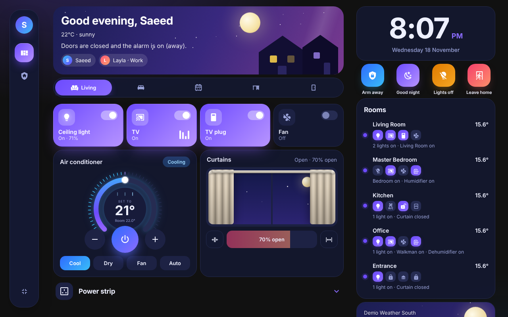

## Why Roost

Built-in cards and other card sets give you clean building blocks, and you assemble the dashboard yourself. Roost gives you the finished thing:

### 1 · A whole dashboard in one tap
Install, open Home Assistant, tap **Make them**: Roost builds a phone dashboard and a tablet dashboard from your own areas and devices, and keeps them up to date as you add things. Change anything later in the visual editor. [How it works](docs/tutorials/12-ready-dashboards.md)


### 2 · Controls you use, not just switches
Drag the AC dial, dim with your finger, watch the curtains slide, slide to unlock, arm the alarm with a question first. Fewer taps into pop-up dialogs.

| | | |
|:-:|:-:|:-:|
| <br>**Drag the dial** | <br>**Curtains really slide** | <br>**Slide to unlock** |

Hold any card and Roost's own details sheet slides up: the name, the state and one main control, nothing else. Swipe up for history and details.


### Right now, not just everything
**Roost Now** shows only what matters at this moment, most urgent first: someone at the door, a leak, the next prayer or the iftar countdown, a door open in the heat, lights left on when everyone is out (one tap turns them off). When all is well, one calm line.

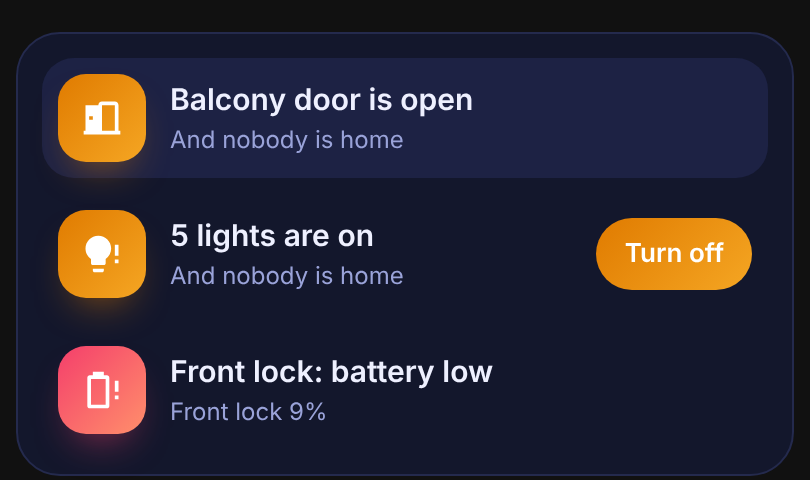

### Your home in 3D
**Roost Home Tour** shows your home as the finished pictures [Roost Atelier](https://github.com/HRadhi4/Roost-Atelier) makes: the whole floor, and every room in 360°, like a street-view tour. Tap a room to step in, drag to look around, follow the arrows on the doors, and tap any light, AC, curtain or TV right on the picture to control it. Lights that are on glow. In the card's settings, choose what tapping a room does: go inside it in 360°, or zoom in on it from above (the whole-home picture flies in to the room so every device is close up). No 3D engine is loaded, so it is quick on phones and tablets.

**Roost 3D Home** brings your home from [Roost Atelier](https://github.com/HRadhi4/Roost-Atelier) onto the dashboard: one calm line about what is going on, the live 3D view (tap a device to control it), and the realistic photos Atelier made of the whole floor and every room. Tap a photo to see it big.

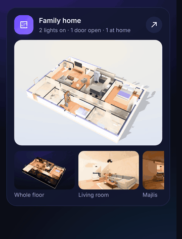

### Arabic, right to left
Every card follows your Home Assistant language. In Arabic the whole dashboard turns right to left, with Arabic words and, if you like, Arabic numbers. Switch between Arabic and English on any screen with one chip.

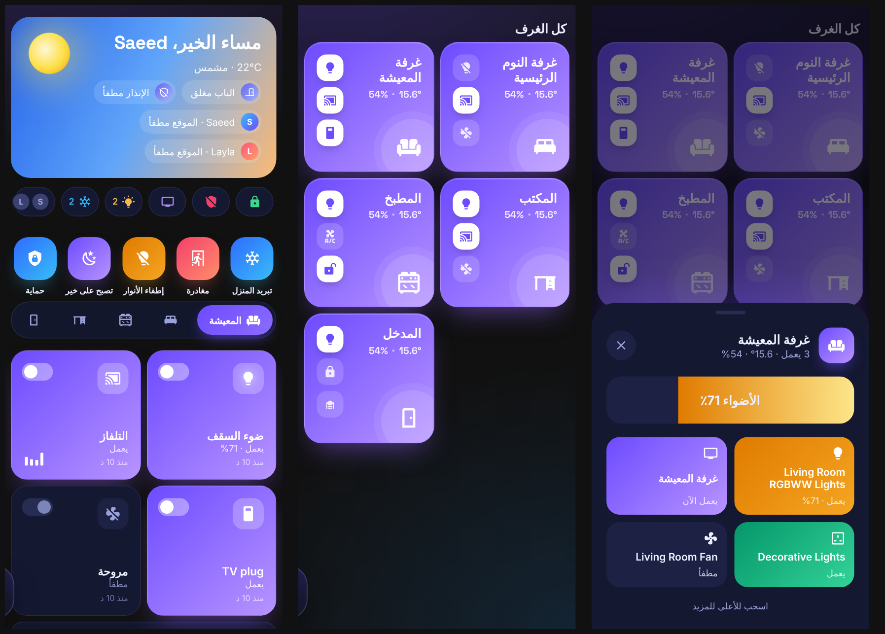

### 3 · Rooms in one card
Swipe between rooms and get each room's devices, temperature, “Someone here” and one slider for all its lights, instead of one long page per room.


### 4 · The home tells you, on its own
A popup opens by itself when water is found, the doorbell rings or the alarm goes off, with a camera picture and buttons like **Turn the water off**. A timeline shows what happened, and a battery card warns before a sensor dies. No extra add-ons needed for popups.

### 5 · Made for a wall tablet, too
Full screen built in (no top bar or sidebar, no kiosk add-on), the bottom bar becomes a side rail, and every card rearranges itself for narrow columns. Light and dark follow your phone.

### And everywhere
- **No code:** every card has a visual editor: device, colours, look, size, what a tap does.
- **Never cut off:** text wraps instead of ending in "…", checked automatically before every release.
- **Calm motion:** things glow, spin and count, and all of it stops when *Reduce motion* is on.
- **Cards for real homes:** water tank, pool, pet feeder, prayer times, medicine, Grocy, bins and more, for when you need them. [See them all](#all-64-cards).

## Install

[](https://my.home-assistant.io/redirect/hacs_repository/?owner=HRadhi4&repository=Roost-card&category=plugin)

1. Tap the button above (or open **HACS** and search for **Roost Cards**).
2. Tap **Download**, then **Reload** when asked.
3. Edit a dashboard → **Add card** → search **Roost**.

Step by step, and without HACS: **[Install guide](docs/tutorials/01-install.md)**.

**No time to build?** The first time you open Home Assistant after installing, Roost offers to make two ready dashboards (phone and tablet) from your own rooms and devices. [How it works](docs/tutorials/12-ready-dashboards.md).

## Tutorials

### Videos

Recorded on a real Home Assistant (its built-in demo devices), so everything you see is the real editor and the real cards.

| Build a dashboard in the visual editor (7 min) | Every card in action (5 min) |
|:-:|:-:|
| [](https://github.com/HRadhi4/Roost-card/blob/main/docs/video/roost-build-dashboard.mp4) | [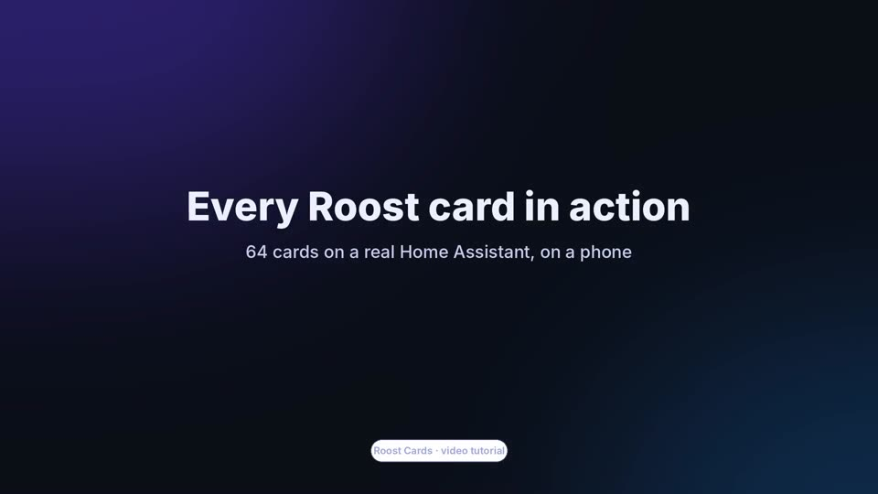](https://github.com/HRadhi4/Roost-card/blob/main/docs/video/roost-every-card.mp4) |
| Make a dashboard, add each card from the card list, pick your devices, open its options, save. Then use it on a phone. | Every card on one page, each one tapped, dragged or switched so you can see what it does. |

### Written, with pictures

0. [Videos: build a dashboard, and every card in action](docs/tutorials/00-video.md)
1. [Install Roost Cards](docs/tutorials/01-install.md) · 2 min
2. [Add your first card](docs/tutorials/02-first-card.md) · 1 min
3. [Build a phone home screen](docs/tutorials/03-phone-home-screen.md) · 10 min
4. [Rooms that switch with a tap](docs/tutorials/04-rooms.md)
5. [Air conditioners, curtains and lights](docs/tutorials/05-climate-and-curtains.md)
6. [Security: alarm, lock, alerts and people](docs/tutorials/06-security.md)
7. [Use it with Athom Hub (remote and presence map)](docs/tutorials/07-with-athom-hub.md)
8. [Full screen, like an app](docs/tutorials/09-full-screen.md)
9. [Looks: frosted glass, light and dark, tablets](docs/tutorials/08-looks.md)
10. [Clock and prayer times](docs/tutorials/10-clock-and-prayer.md)
11. [Try cards before you own the device](docs/tutorials/11-try-without-devices.md)
12. [Ready dashboards made from your home](docs/tutorials/12-ready-dashboards.md) · no work
13. [Batteries, Timeline, your own values, group tiles](docs/tutorials/13-batteries-timeline-values.md)
14. [Real-looking curtains, blinds, garage, plant, pet and pool](docs/tutorials/14-real-looks.md)
15. [Guest Wi-Fi, Announce, Kitchen, Kids' internet, notes, deliveries, power backup](docs/tutorials/15-new-cards.md)
16. [Your car: realistic, in its own colour, and more than one](docs/tutorials/16-your-car.md)

## All 64 cards

Each GIF shows the card in use, then in the other colour mode, then as frosted glass.

| Card | What it is | See it |
|---|---|:-:|
| **Roost Tile** | A big tile with a switch. Shows the state, the power used and how long it has been on. Glows or spins when on. | <picture><source media="(prefers-color-scheme: dark)" srcset="https://raw.githubusercontent.com/HRadhi4/Roost-card/main/docs/gifs/cards-dark/tile.gif"></picture> |
| **Roost Chips** | Status chips in one row: doors, alarm, air conditioner, TV. Lights become one bulb with a count, people become little bubbles (colour = home, grey = away). Tap the bulb or the bubbles for the list. Six looks: pills, one status bar, a line for anything that needs you, rings that fill, grouped, or a glass dock. | <picture><source media="(prefers-color-scheme: dark)" srcset="https://raw.githubusercontent.com/HRadhi4/Roost-card/main/docs/gifs/cards-dark/chips.gif"></picture> |
| **Roost Thermostat** | An air conditioner card with a **dial you drag with your finger**, a power button, − and +, and mode buttons. A lock keeps it from being dialled by mistake. The Nest look glows and shows a breeze while it runs. | <picture><source media="(prefers-color-scheme: dark)" srcset="https://raw.githubusercontent.com/HRadhi4/Roost-card/main/docs/gifs/cards-dark/thermostat.gif"></picture> |
| **Roost Scene** | A coloured card or round button that runs a scene or script. A tick shows when it is done. | <picture><source media="(prefers-color-scheme: dark)" srcset="https://raw.githubusercontent.com/HRadhi4/Roost-card/main/docs/gifs/cards-dark/scene.gif">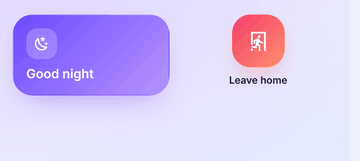</picture> |
| **Roost Scenes** | A row of round scene buttons in one card, spread evenly and centred however many there are, names kept under their own button. Or stacked like a dock: the button under your finger lifts and shows its name. | <picture><source media="(prefers-color-scheme: dark)" srcset="https://raw.githubusercontent.com/HRadhi4/Roost-card/main/docs/gifs/cards-dark/scenes.gif"></picture> |
| **Roost Top Bar** | A bar pinned to the top of the screen in the bottom bar's frosted glass: back and forward buttons, the page's name (or your own title), the time, and buttons of your own on the right. | <picture><source media="(prefers-color-scheme: dark)" srcset="https://raw.githubusercontent.com/HRadhi4/Roost-card/main/docs/gifs/cards-dark/top-bar.gif"></picture> |
| **Roost Hero** | A greeting with a sky that follows the sun (stars at night), the time, date, weather and a "what's next" countdown. | <picture><source media="(prefers-color-scheme: dark)" srcset="https://raw.githubusercontent.com/HRadhi4/Roost-card/main/docs/gifs/cards-dark/hero.gif"></picture> |
| **Roost Row** | A long row with a ring (an AC's temperature or any number), a name, a state line and an arrow. | <picture><source media="(prefers-color-scheme: dark)" srcset="https://raw.githubusercontent.com/HRadhi4/Roost-card/main/docs/gifs/cards-dark/row.gif"></picture> |
| **Roost Nav** | Icon navigation: a bar at the bottom on phones, a rail at the side on tablets. | <picture><source media="(prefers-color-scheme: dark)" srcset="https://raw.githubusercontent.com/HRadhi4/Roost-card/main/docs/gifs/cards-dark/nav.gif"></picture> |
| **Roost Curtain** | A window with curtains that really slide open and closed, a sky behind them, and Open / Stop / Close buttons. Add a gypsum curtain box, a cornice, a hidden light or a fabric pelmet. | <picture><source media="(prefers-color-scheme: dark)" srcset="https://raw.githubusercontent.com/HRadhi4/Roost-card/main/docs/gifs/cards-dark/curtain.gif"></picture> |
| **Roost Gauge** | A big ring for one reading (a cabinet's temperature, a plug's power). Turns orange and glows when too high, with a second reading under it. | <picture><source media="(prefers-color-scheme: dark)" srcset="https://raw.githubusercontent.com/HRadhi4/Roost-card/main/docs/gifs/cards-dark/gauge.gif"></picture> |
| **Roost Graph** | A smooth line of a reading over the last hours, with the lowest and highest. | <picture><source media="(prefers-color-scheme: dark)" srcset="https://raw.githubusercontent.com/HRadhi4/Roost-card/main/docs/gifs/cards-dark/graph.gif"></picture> |
| **Roost Room** | One room at a glance: temperature bar, humidity and what is on, open or running. Tap to open the room. Put any cards under it, in one box or folded away. | <picture><source media="(prefers-color-scheme: dark)" srcset="https://raw.githubusercontent.com/HRadhi4/Roost-card/main/docs/gifs/cards-dark/room.gif"></picture> |
| **Roost Light** | A light with brightness you drag, warm / neutral / cool buttons and colour dots. | <picture><source media="(prefers-color-scheme: dark)" srcset="https://raw.githubusercontent.com/HRadhi4/Roost-card/main/docs/gifs/cards-dark/light.gif"></picture> |
| **Roost Media** | TV and sound: power, what is playing (with moving sound bars), volume you drag, mute, play/pause and inputs. | <picture><source media="(prefers-color-scheme: dark)" srcset="https://raw.githubusercontent.com/HRadhi4/Roost-card/main/docs/gifs/cards-dark/media.gif"></picture> |
| **Roost Alarm** | The alarm in a big shield: arm and disarm with a question first, a keypad when it needs a code, and the doors. | <picture><source media="(prefers-color-scheme: dark)" srcset="https://raw.githubusercontent.com/HRadhi4/Roost-card/main/docs/gifs/cards-dark/alarm.gif"></picture> |
| **Roost People** | Who is home: a picture or initials with a green ring when home, and for how long. | <picture><source media="(prefers-color-scheme: dark)" srcset="https://raw.githubusercontent.com/HRadhi4/Roost-card/main/docs/gifs/cards-dark/people.gif"></picture> |
| **Roost Automations** | A list of automations with a switch, when each last ran, and an optional "run now" button. | <picture><source media="(prefers-color-scheme: dark)" srcset="https://raw.githubusercontent.com/HRadhi4/Roost-card/main/docs/gifs/cards-dark/automations.gif">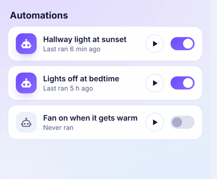</picture> |
| **Roost Clock** | A clock with eight faces (digital, analog, minimal, flip, ring, words, neon, LCD), any time zone and world clocks. | <picture><source media="(prefers-color-scheme: dark)" srcset="https://raw.githubusercontent.com/HRadhi4/Roost-card/main/docs/gifs/cards-dark/clock.gif"></picture> |
| **Roost Prayer Times** | Today's prayer times, the next one with a countdown and the Hijri date: calculated with any method, from your sensors, or online. | <picture><source media="(prefers-color-scheme: dark)" srcset="https://raw.githubusercontent.com/HRadhi4/Roost-card/main/docs/gifs/cards-dark/prayer.gif"></picture> |
| **Roost Alerts** | Only shows when something needs you: a low battery, a device gone offline, a door left open, or your own rules. | <picture><source media="(prefers-color-scheme: dark)" srcset="https://raw.githubusercontent.com/HRadhi4/Roost-card/main/docs/gifs/cards-dark/alerts.gif"></picture> |
| **Roost Title** | A section heading with an optional line under it, a badge and a "See all" link. | <picture><source media="(prefers-color-scheme: dark)" srcset="https://raw.githubusercontent.com/HRadhi4/Roost-card/main/docs/gifs/cards-dark/title.gif"></picture> |
| **Roost Light/Dark** | A sun / moon button that switches this screen between light and dark. | <picture><source media="(prefers-color-scheme: dark)" srcset="https://raw.githubusercontent.com/HRadhi4/Roost-card/main/docs/gifs/cards-dark/theme.gif"></picture> |
| **Roost Remote** | A remote-control pad for an Athom Hub remote, any remote, or a TV: round arrow pad or a swipe touch pad, volume and channels, play and skip, coloured keys, numbers and your own app shortcuts. Show only the parts you want. |  |
| **Roost Presence Map** | The room from above as a presence radar sees it (for example the LD2450 in an Athom sensor): people as glowing moving dots, and its zones with how many are inside. |  |
| **Roost Weather** | The weather now on an animated sky (rain falls, clouds drift, storms flash, stars at night), and the next days or hours. | <picture><source media="(prefers-color-scheme: dark)" srcset="https://raw.githubusercontent.com/HRadhi4/Roost-card/main/docs/gifs/cards-dark/weather.gif"></picture> |
| **Roost Energy** | Power used now, today against yesterday, and the hungriest devices as bars. | <picture><source media="(prefers-color-scheme: dark)" srcset="https://raw.githubusercontent.com/HRadhi4/Roost-card/main/docs/gifs/cards-dark/energy.gif"></picture> |
| **Roost Timer** | A countdown ring for a timer (kettle, washing) with start, pause, cancel and quick times. | <picture><source media="(prefers-color-scheme: dark)" srcset="https://raw.githubusercontent.com/HRadhi4/Roost-card/main/docs/gifs/cards-dark/timer.gif">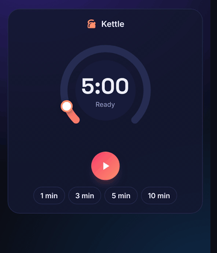</picture> |
| **Roost Fan** | Turn a dial to set the speed (the fan spins faster at each step), or a big square dial like the thermostat with the room's temperature and humidity. Swing, direction and modes are small chips. | <picture><source media="(prefers-color-scheme: dark)" srcset="https://raw.githubusercontent.com/HRadhi4/Roost-card/main/docs/gifs/cards-dark/fan.gif"></picture> |
| **Roost Air** | An air purifier or a room's air: a ring coloured by how clean the air is, air drawn in while it runs, mode, speed and filter life. |  |
| **Roost Water Heater** | A water tank that shows how hot it is, bubbles while it heats, the set temperature and “heat for 30 min” buttons. | 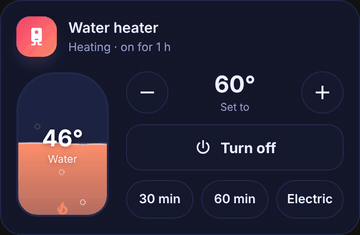 |
| **Roost Doorbell** | The door camera, a banner when someone rings, the last rings and the door lock (tap twice to unlock). |  |
| **Roost Laundry** | A washer, dryer or dishwasher: the drum turns, the steps of the cycle, time left, when it finishes, and “ready to unload”. | 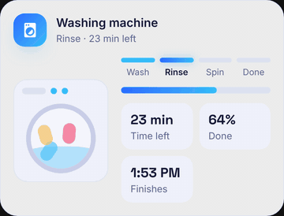 |
| **Roost Garage** | A garage door that rolls up (or a gate that slides or swings), how long it has been open, and a warning when it stays open. |  |
| **Roost Energy Flow** | Sun, house, battery and grid with power flowing between them, faster when more power moves. | 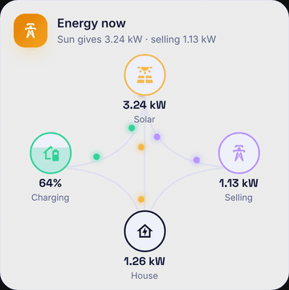 |
| **Roost Irrigation** | Garden zones: tap to water for a few minutes, see what is watering, and skip when rain is coming. |  |
| **Roost Car** | Your car, petrol or electric, as a realistic picture in its own colour (or a drawn one). Fuel or battery, range, charging and the lock; cool it before you go, flash the lights to find it, and see an open door or boot. Several cars? Swipe between them. | <picture><source media="(prefers-color-scheme: dark)" srcset="https://raw.githubusercontent.com/HRadhi4/Roost-card/main/docs/gifs/cards-dark/car.gif">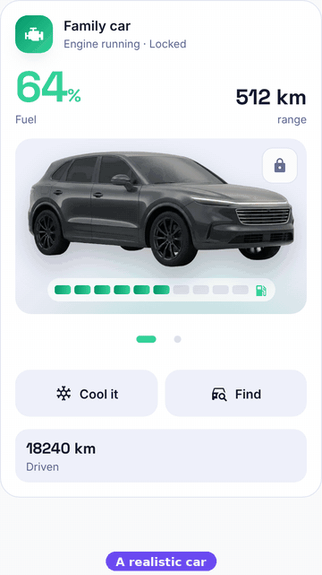</picture> |
| **Roost Plant** | A potted plant that droops when it is thirsty and says what it needs: water, light, warmth or food. | 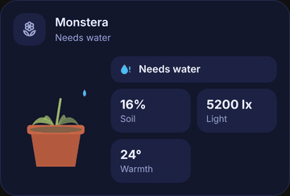 |
| **Roost Printer** | Ink or toner levels as little bottles, or a 3D print growing layer by layer with time left and temperatures. |  |
| **Roost Moments** | Your day in moments (morning, day, evening, bedtime) with the scene that fits right now. |  |
| **Roost Family Map** | Where everyone is, drawn simply around home (no map service): places as circles, people as faces, how far away. |  |
| **Roost Popup** | One popup for everything: the doorbell with its camera, alarms, leaks, a door left open, the washing done, or any cards. It opens by itself when a device changes, from a link or button, or from an automation. Every “Are you sure?” in Roost uses it too. |  |
| **Roost Grocy** | The kitchen from Grocy: food that goes off soon, the shopping list to tick off, chores, tasks and the meal plan. |  |
| **Roost Tank** | A water tank or gas cylinder: how full it is (the water sways), used today, days left, a leak warning and the pump. |  |
| **Roost Pool** | The pool from above with light moving on the water: warmth, chlorine and pH with the good zone, pump, heater and light. | 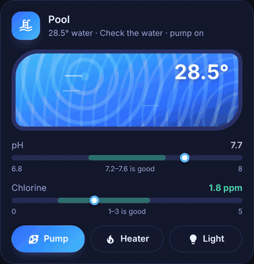 |
| **Roost Pet** | A pet feeder and water fountain: food and water left, when it last ate, meals today and “feed now”. | 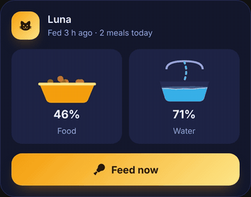 |
| **Roost Nursery** | The baby's room: camera, warmth and humidity, a banner when the baby cries, night light and lullaby. |  |
| **Roost Network** | The internet (download, upload, ping, devices online) or a server (CPU, memory, disk, heat), with a restart you tap twice. |  |
| **Roost Guest Wi-Fi** | A QR code guests point their phone camera at to join your Wi-Fi. Show the password or share it with one tap; turn the guest network on if it is off. | <picture><source media="(prefers-color-scheme: dark)" srcset="https://raw.githubusercontent.com/HRadhi4/Roost-card/main/docs/gifs/cards-dark/wifi.gif"></picture> |
| **Roost Announce** | Type, pick a ready message or speak, choose the rooms, and it plays on those speakers like an intercom ("Dinner is ready"). Works with smart speakers and Home Assistant voice devices. | <picture><source media="(prefers-color-scheme: dark)" srcset="https://raw.githubusercontent.com/HRadhi4/Roost-card/main/docs/gifs/cards-dark/announce.gif"></picture> |
| **Roost Kitchen** | The oven, air fryer, dishwasher and coffee machine in one card: what each is doing, time left with a ring, and a green "Ready to serve". | <picture><source media="(prefers-color-scheme: dark)" srcset="https://raw.githubusercontent.com/HRadhi4/Roost-card/main/docs/gifs/cards-dark/kitchen.gif"></picture> |
| **Roost Kids' internet** | Each child's phone or tablet: online or paused, one tap to pause or resume (tap twice if you like), and a bedtime switch. Uses your router's internet switch for each device. | <picture><source media="(prefers-color-scheme: dark)" srcset="https://raw.githubusercontent.com/HRadhi4/Roost-card/main/docs/gifs/cards-dark/kids.gif">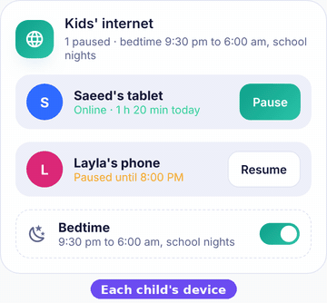</picture> |
| **Roost Family notes** | Short sticky notes everyone sees on the tablet ("Buy milk", "Back at 8"), with who wrote them and when. Kept in a Home Assistant to-do list, so they are the same on every screen. | <picture><source media="(prefers-color-scheme: dark)" srcset="https://raw.githubusercontent.com/HRadhi4/Roost-card/main/docs/gifs/cards-dark/notes.gif"></picture> |
| **Roost Deliveries** | Parcels on their way, each with a step bar (ordered, on its way, out for delivery, delivered) and the day it comes. Works with parcel-tracking sensors such as 17TRACK. | <picture><source media="(prefers-color-scheme: dark)" srcset="https://raw.githubusercontent.com/HRadhi4/Roost-card/main/docs/gifs/cards-dark/deliveries.gif"></picture> |
| **Roost Power backup** | The UPS: battery ring, how long the home keeps running in a power cut, power used, and what it keeps on. | <picture><source media="(prefers-color-scheme: dark)" srcset="https://raw.githubusercontent.com/HRadhi4/Roost-card/main/docs/gifs/cards-dark/backup.gif">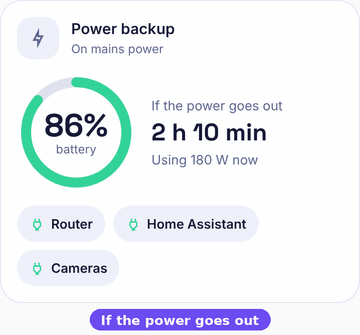</picture> |
| **Roost Batteries** | Every battery in the home, lowest first, with a calm “All good” when none are low. Finds them by itself. |  |
| **Roost Timeline** | What happened at home, newest first: doors, locks, people coming and going, alarms and leaks. |  |
| **Roost Values** | Your own settings in one card: numbers to slide, choices to tap, switches, short texts. |  |
| **Roost Bins** | Which bin goes out next, drawn as coloured wheelie bins; tonight's one bounces. | 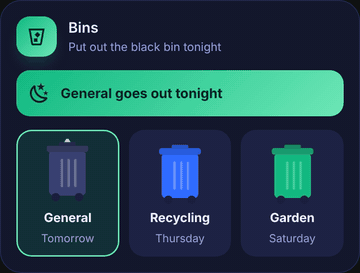 |
| **Roost Medicine** | Today's doses as pills to tick off, the next dose, and a warning for a missed one. |  |
| **Roost Modes** | House modes (home, away, holiday, guests): away checks doors and windows, guests get a Wi-Fi code to scan. | 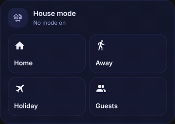 |
| **Roost Sleep** | The night from bedtime to the alarm with the moon moving along, a good-night button and how last night went. |  |
| **Roost Vacuum** | A robot vacuum on its little floor: cleans in lanes (a wet trail when it mops), spirals for a spot clean, drives home and charges. Pick rooms, suction and mop settings; see when the filter or brushes need care; switch to the robot's map. Drawings of the common robots (Roborock, Dreame, Eufy, Shark, Roomba, Ecovacs) or your own picture. |  |
| **Roost Lock** | A lock or garage door: slide to unlock, tap to lock; says when it is jammed. | <picture><source media="(prefers-color-scheme: dark)" srcset="https://raw.githubusercontent.com/HRadhi4/Roost-card/main/docs/gifs/cards-dark/lock.gif"></picture> |
| **Roost Agenda** | Today's and the next days' calendar events. Bin day (or any word you choose) stands out. | <picture><source media="(prefers-color-scheme: dark)" srcset="https://raw.githubusercontent.com/HRadhi4/Roost-card/main/docs/gifs/cards-dark/agenda.gif"></picture> |
| **Roost To-do** | A to-do or shopping list: tick off, add and clear. | <picture><source media="(prefers-color-scheme: dark)" srcset="https://raw.githubusercontent.com/HRadhi4/Roost-card/main/docs/gifs/cards-dark/todo.gif"></picture> |
| **Roost Camera** | A camera picture or live video, with a banner when someone rings the doorbell. |  |
| **Roost Sensors** | Many small readings in neat squares, orange when out of the range you set. | <picture><source media="(prefers-color-scheme: dark)" srcset="https://raw.githubusercontent.com/HRadhi4/Roost-card/main/docs/gifs/cards-dark/sensors.gif"></picture> |
| **Roost Buttons** | Several small actions in one rounded bar; a button lights up when its device is on, in the same six looks as the bottom bar. | <picture><source media="(prefers-color-scheme: dark)" srcset="https://raw.githubusercontent.com/HRadhi4/Roost-card/main/docs/gifs/cards-dark/buttons.gif"></picture> |
| **Roost Full Screen** | Hides Home Assistant's top bar and sidebar so your dashboard feels like an app: by itself (invisible), as a button that maximizes and minimizes, or as the tap action of any card. Comes back while editing. | <picture><source media="(prefers-color-scheme: dark)" srcset="https://raw.githubusercontent.com/HRadhi4/Roost-card/main/docs/gifs/cards-dark/fullscreen.gif"></picture> |
| **Roost Page** | A whole phone page laid out like the original: even spacing, the night-sky background and room for the bottom bar. | <picture><source media="(prefers-color-scheme: dark)" srcset="https://raw.githubusercontent.com/HRadhi4/Roost-card/main/docs/gifs/cards-dark/page.gif">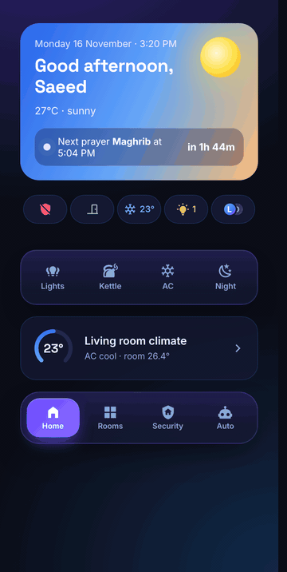</picture> |
| **Roost Panel** | A rounded box with a title that holds other cards, such as a list of rooms. It can fold open and closed. | <picture><source media="(prefers-color-scheme: dark)" srcset="https://raw.githubusercontent.com/HRadhi4/Roost-card/main/docs/gifs/cards-dark/panel.gif"></picture> |
| **Roost Home Tour** | Your home as pictures from Roost Atelier: the whole floor and every room in 360°, with every device on the picture. | |
| **Roost 3D Home** | Your home from Roost Atelier: what is going on, the live 3D view and realistic photos of every room. |  |
| **Roost Now** | What matters right now, most urgent first; one calm line when all is well. |  |
| **Roost Rooms Selector** | A room switcher: tap a room pill and that room's cards appear below, instantly. | <picture><source media="(prefers-color-scheme: dark)" srcset="https://raw.githubusercontent.com/HRadhi4/Roost-card/main/docs/gifs/cards-dark/rooms.gif"></picture> |


Every setting of every card, with YAML to copy: **[docs/cards.md](docs/cards.md)**.

<details>
<summary><b>More screenshots</b></summary>

**Air conditioner, curtains and lights**


**TV and sound, and the remote**


**Readings, graph and energy**
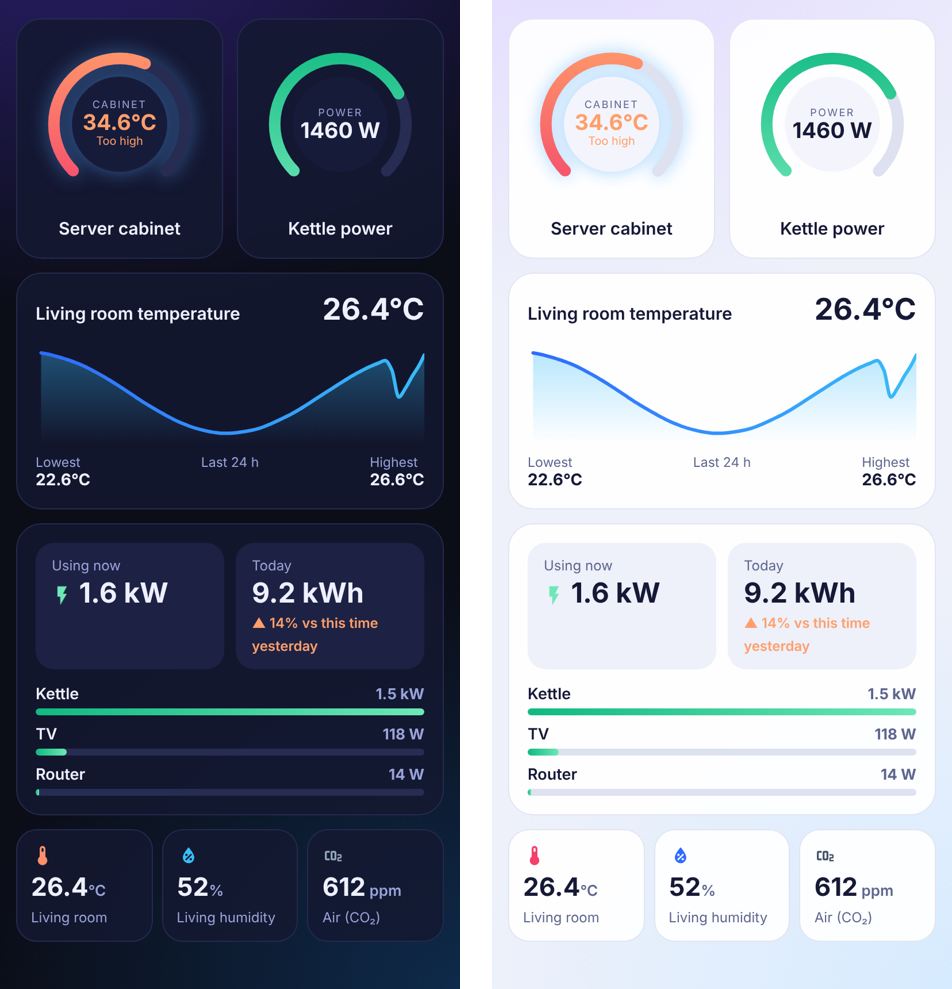

**Security**
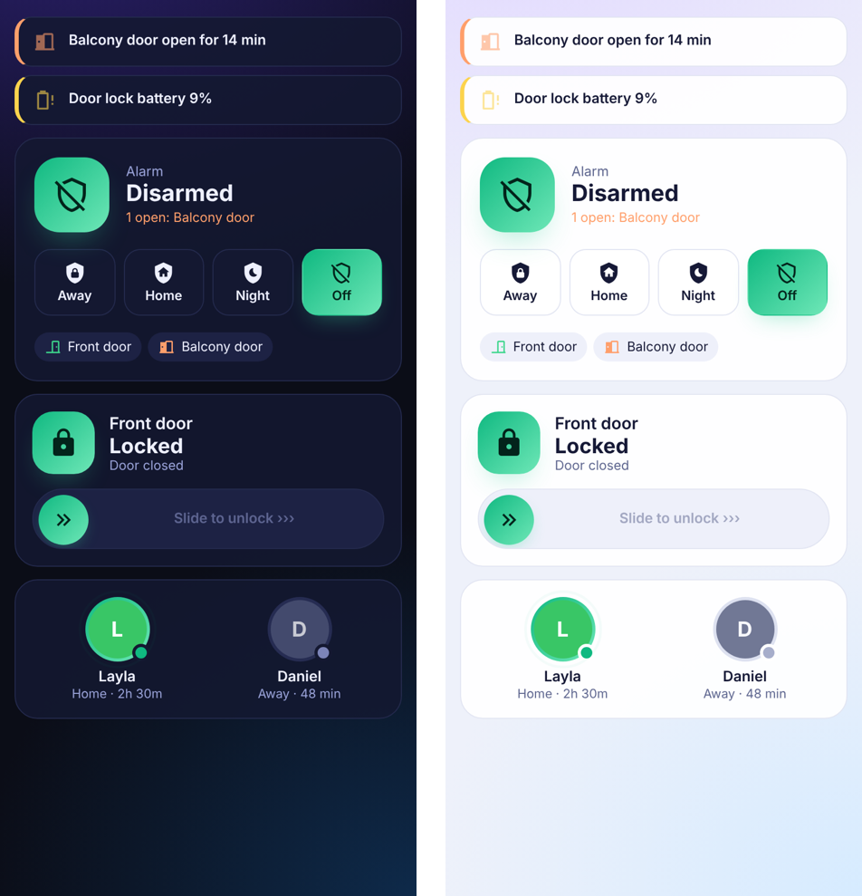

**Your day**
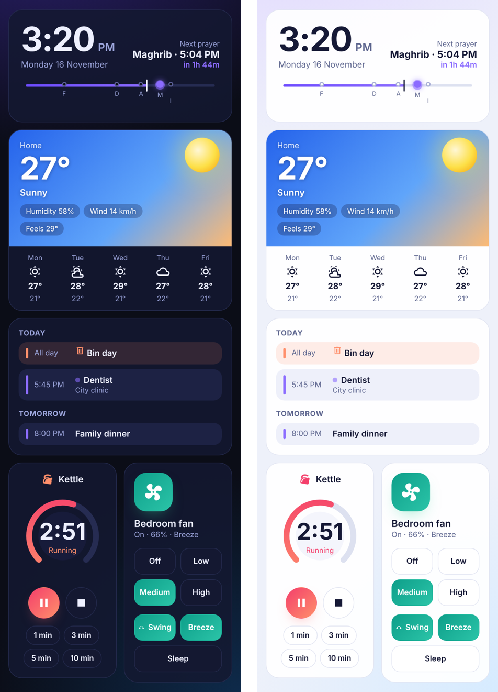

**Rooms and lists**
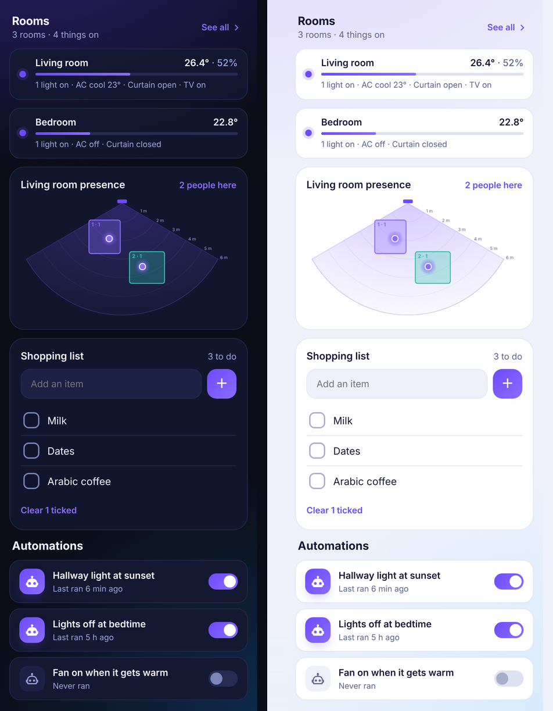

</details>

## Keep your Home Assistant up to date automatically

HACS shows new versions by itself. If you also want them installed by themselves, this automation installs every new version by itself, as soon as it is released:
```yaml
alias: Keep Roost Cards up to date
triggers:
  - trigger: state
    entity_id: update.roost_cards_update
    to: "on"
actions:
  - action: update.install
    target:
      entity_id: update.roost_cards_update
```
After an update, pull down on your phone (or reload the page) to see it.

## Questions and problems

| What you see | What to do |
|---|---|
| "Custom element doesn't exist: roost-…" | The file is not loaded yet. Check the resource (see *Install*) and refresh the page. On a phone, close the app fully and open it again. |
| A card says "Device not found" | The device was renamed or removed. Choose it again in the card editor. |
| The thermostat has no knob | That air conditioner has no temperature setting in Home Assistant. |
| My phone still shows the old look after an update | Close the Home Assistant app completely and open it again (on a computer, reload the page). |
| My curtain says "open" when it is closed | Turn on **Reverse** in the curtain card or tile ([how](docs/tutorials/05-climate-and-curtains.md#my-curtain-says-open-when-its-closed)). |
| I can't find the bottom bar to edit it | While editing, it sits at the end of the page with a small note. Tap it there. |
| Something else | [Open an issue](https://github.com/HRadhi4/Roost-card/issues/new/choose) with a screenshot. |

## For developers

The whole library is one file, `dist/roost-cards.js`, with no build step. To check it:
```
npm install
npm test
```
Releases are made automatically when the version in `package.json` goes up; the notes come from `CHANGELOG.md`.

## Support

If Roost Cards makes your home nicer, you can buy me a coffee on Ko-fi. It helps me keep adding features and fixing problems.

<a href="https://ko-fi.com/hradhi4"></a>

## License

GPL-3.0. See [LICENSE](LICENSE).
