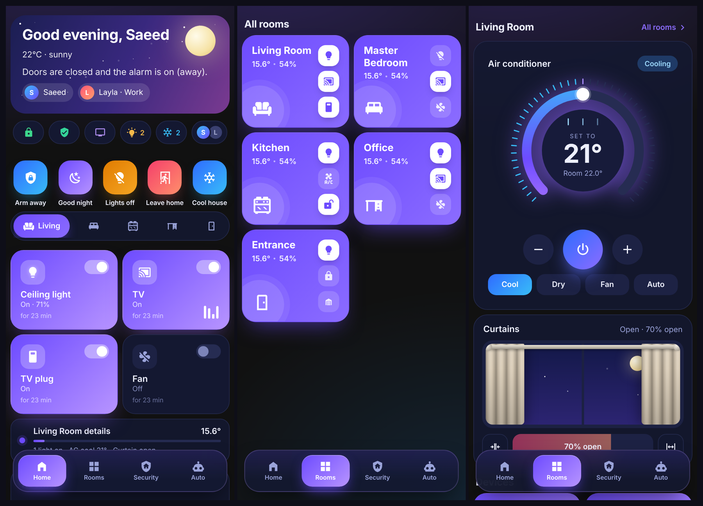
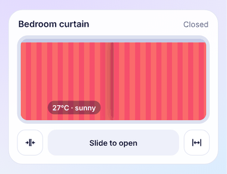
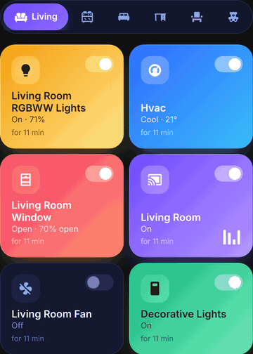
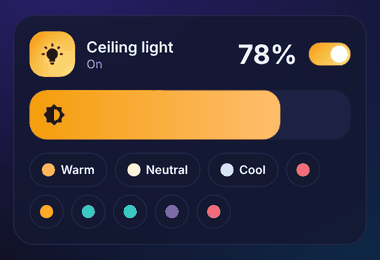
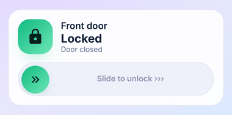
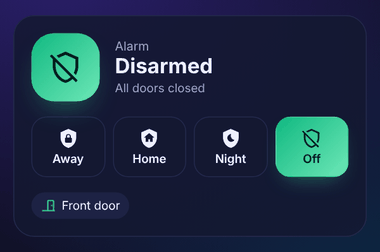
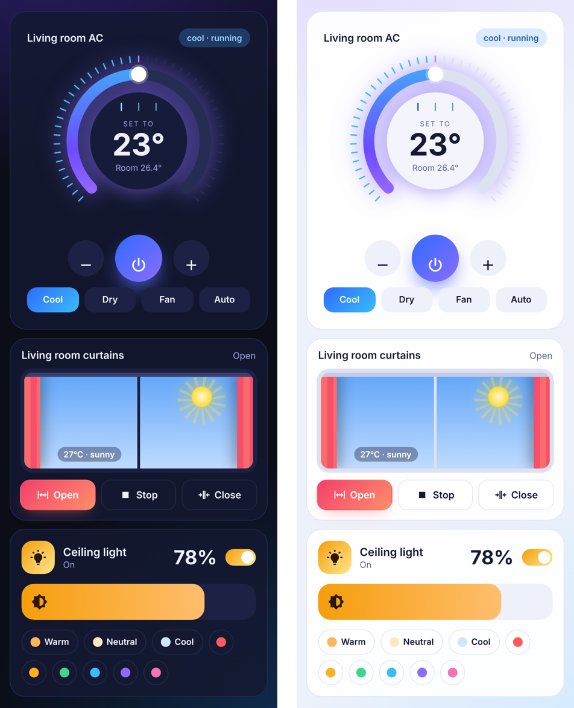
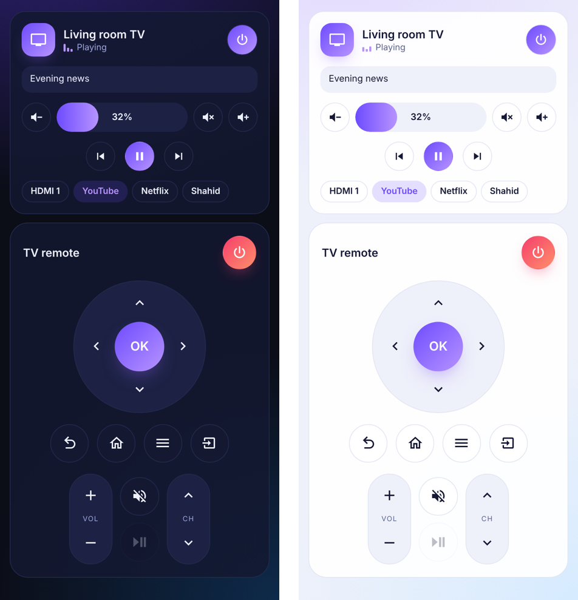

<h1 align="center">Roost Cards</h1>

<p align="center"><b>Beautiful, animated dashboard cards for Home Assistant. Made for phones and tablets.</b><br>
34 cards · a visual editor for every setting · light and dark · no code needed</p>

<p align="center">
<a href="https://hacs.xyz"></a>
<a href="https://github.com/HRadhi4/Roost-card/releases/latest"></a>
<a href="https://github.com/HRadhi4/Roost-card/actions/workflows/validate.yml"></a>
<a href="LICENSE"></a>
</p>

<p align="center">
<a href="https://my.home-assistant.io/redirect/hacs_repository/?owner=HRadhi4&repository=Roost-card&category=plugin"></a>
</p>



## Highlights

- **Feels like an app.** Tiles glow, fans spin, curtains really slide, the TV shows moving sound bars, the alarm pulses while armed.
- **Made for fingers.** Drag the thermostat dial and the light's brightness, slide to unlock, swipe between rooms.
- **No code.** Every card has a visual editor: device, colours, looks, size, icon, shape, what a tap does.
- **Never cut off.** Text never ends in "…"; long names wrap. Checked automatically before every release.
- **Light and dark.** Follows your phone, or stays the way you choose. Stops moving when *Reduce motion* is on.
- **Phone and tablet.** The bottom bar becomes a side rail on tablets, and every card rearranges itself when it sits in a narrow column.
- **Full screen built in.** No top bar or sidebar, like an app, without a separate add-on.

| | | |
|:-:|:-:|:-:|
| <br>**Drag the dial** | <br>**Curtains really slide** | <br>**Switch rooms instantly** |
| <br>**Dim with your finger** | <br>**Slide to unlock** | <br>**Arm with a question first** |

## Install

[](https://my.home-assistant.io/redirect/hacs_repository/?owner=HRadhi4&repository=Roost-card&category=plugin)

1. Tap the button above (or open **HACS** and search for **Roost Cards**).
2. Tap **Download**, then **Reload** when asked.
3. Edit a dashboard → **Add card** → search **Roost**.

Step by step, and without HACS: **[Install guide](docs/tutorials/01-install.md)**.

## Tutorials

Short, written, with pictures:

1. [Install Roost Cards](docs/tutorials/01-install.md) · 2 min
2. [Add your first card](docs/tutorials/02-first-card.md) · 1 min
3. [Build a phone home screen](docs/tutorials/03-phone-home-screen.md) · 10 min
4. [Rooms that switch with a tap](docs/tutorials/04-rooms.md)
5. [Air conditioners, curtains and lights](docs/tutorials/05-climate-and-curtains.md)
6. [Security: alarm, lock, alerts and people](docs/tutorials/06-security.md)
7. [Use it with Athom Hub (remote and presence map)](docs/tutorials/07-with-athom-hub.md)
8. [Full screen, like an app](docs/tutorials/09-full-screen.md)
9. [Looks, light and dark, tablets](docs/tutorials/08-looks.md)

## All 34 cards

| Card | What it is |
|---|---|
| **Roost Tile** | A big tile with a switch. Shows the state, the power used and how long it has been on. Glows or spins when on. |
| **Roost Chips** | Status chips in one row: doors, alarm, air conditioner, TV. Lights become one bulb with a count, people become little bubbles (colour = home, grey = away). Tap the bulb or the bubbles for the list. |
| **Roost Thermostat** | An air conditioner card with a **dial you drag with your finger**, a power button, − and +, and mode buttons. |
| **Roost Scene** | A coloured card or round button that runs a scene or script. A tick shows when it is done. |
| **Roost Hero** | A greeting with a sky that follows the sun (stars at night), the time, date, weather and a "what's next" countdown. |
| **Roost Row** | A long row with a ring (an AC's temperature or any number), a name, a state line and an arrow. |
| **Roost Nav** | Icon navigation: a bar at the bottom on phones, a rail at the side on tablets. |
| **Roost Curtain** | A window with curtains that really slide open and closed, a sky behind them, and Open / Stop / Close buttons. |
| **Roost Gauge** | A big ring for one reading (a cabinet's temperature, a plug's power). Turns orange and glows when too high, with a second reading under it. |
| **Roost Graph** | A smooth line of a reading over the last hours, with the lowest and highest. |
| **Roost Room** | One room at a glance: temperature bar, humidity and what is on, open or running. Tap to open the room. |
| **Roost Light** | A light with brightness you drag, warm / neutral / cool buttons and colour dots. |
| **Roost Media** | TV and sound: power, what is playing (with moving sound bars), volume you drag, mute, play/pause and inputs. |
| **Roost Alarm** | The alarm in a big shield: arm and disarm with a question first, a keypad when it needs a code, and the doors. |
| **Roost People** | Who is home: a picture or initials with a green ring when home, and for how long. |
| **Roost Automations** | A list of automations with a switch, when each last ran, and an optional "run now" button. |
| **Roost Clock** | A big clock and date with a line of the day's times (such as prayer times) and a countdown to the next one. |
| **Roost Alerts** | Only shows when something needs you: a low battery, a device gone offline, a door left open, or your own rules. |
| **Roost Title** | A section heading with an optional line under it, a badge and a "See all" link. |
| **Roost Light/Dark** | A sun / moon button that switches this screen between light and dark. |
| **Roost Remote** | A remote-control pad (power, arrows, OK, volume, channels, numbers) for an Athom Hub remote, any remote, or a TV. Keys it cannot send are greyed out. |
| **Roost Presence Map** | The room from above as a presence radar sees it (for example the LD2450 in an Athom sensor): people as glowing moving dots, and its zones with how many are inside. |
| **Roost Weather** | The weather now on an animated sky (rain falls, clouds drift, storms flash, stars at night), and the next days or hours. |
| **Roost Energy** | Power used now, today against yesterday, and the hungriest devices as bars. |
| **Roost Timer** | A countdown ring for a timer (kettle, washing) with start, pause, cancel and quick times. |
| **Roost Fan** | A fan that spins as fast as it is set, with speed buttons, swing and its modes. |
| **Roost Lock** | A lock or garage door: slide to unlock, tap to lock; says when it is jammed. |
| **Roost Agenda** | Today's and the next days' calendar events. Bin day (or any word you choose) stands out. |
| **Roost To-do** | A to-do or shopping list: tick off, add and clear. |
| **Roost Camera** | A camera picture or live video, with a banner when someone rings the doorbell. |
| **Roost Sensors** | Many small readings in neat squares, orange when out of the range you set. |
| **Roost Buttons** | Several small actions in one rounded bar; a button lights up when its device is on. |
| **Roost Full Screen** | Hides Home Assistant's top bar and sidebar so your dashboard feels like an app: by itself (invisible), as a button that maximizes and minimizes, or as the tap action of any card. Comes back while editing. |
| **Roost Rooms** | A room switcher: tap a room pill and that room's cards appear below, instantly. |


Every setting of every card, with YAML to copy: **[docs/cards.md](docs/cards.md)**.

<details>
<summary><b>More screenshots</b></summary>

**Air conditioner, curtains and lights**


**TV and sound, and the remote**


**Readings, graph and energy**


**Security**


**Your day**


**Rooms and lists**


</details>

## Keep your Home Assistant up to date automatically

HACS shows new versions by itself. If you also want them installed by themselves, this automation installs every new version by itself, as soon as it is released:
```yaml
alias: Keep Roost Cards up to date
triggers:
  - trigger: state
    entity_id: update.roost_cards_update
    to: "on"
actions:
  - action: update.install
    target:
      entity_id: update.roost_cards_update
```
After an update, pull down on your phone (or reload the page) to see it.

## Questions and problems

| What you see | What to do |
|---|---|
| "Custom element doesn't exist: roost-…" | The file is not loaded yet. Check the resource (see *Install*) and refresh the page. On a phone, close the app fully and open it again. |
| A card says "Device not found" | The device was renamed or removed. Choose it again in the card editor. |
| The thermostat has no knob | That air conditioner has no temperature setting in Home Assistant. |
| My phone still shows the old look after an update | Close the Home Assistant app completely and open it again (on a computer, reload the page). |
| My curtain says "open" when it is closed | Turn on **Reverse** in the curtain card or tile ([how](docs/tutorials/05-climate-and-curtains.md#my-curtain-says-open-when-its-closed)). |
| I can't find the bottom bar to edit it | While editing, it sits at the end of the page with a small note. Tap it there. |
| Something else | [Open an issue](https://github.com/HRadhi4/Roost-card/issues/new/choose) with a screenshot. |

## For developers

The whole library is one file, `dist/roost-cards.js`, with no build step. To check it:
```
npm install
npm test
```
Releases are made automatically when the version in `package.json` goes up; the notes come from `CHANGELOG.md`.

## License

GPL-3.0. See [LICENSE](LICENSE).
