## Roost 3D Home

Your home from [Roost Atelier](https://github.com/HRadhi4/Roost-Atelier) (install it first, then draw your home): a head with one calm line (lights on, doors open, who is home), the live 3D view and the realistic photos Atelier makes by itself of the whole floor and every room. Tap a photo to see it big; the arrow opens Atelier (for admins).

```yaml
type: custom:roost-3d-home
plan: ""          # empty = your first home
floor: 0          # 0 = ground level
view: 3d          # 3d, top or walk
height: 320       # height of the 3D view
live: true        # the live 3D view
photos: true      # the realistic photos
```
Without Roost Atelier the card says how to install it.


## Roost Now

What matters right now, most urgent first: the alarm, a leak or smoke, someone at the door, the next prayer or iftar, a door open in the heat or when nobody is home, lights left on, low batteries. One calm line when all is well.

```yaml
type: custom:roost-now
max: 3                 # most things at once
doorbell: binary_sensor.front_doorbell
camera: camera.front_door
hot: 38                # "it is hot outside" from this temperature
prayer: true           # the next prayer, and iftar in Ramadan
method: makkah
hide_calm: false       # hide the card when nothing needs you
```
Doors, windows, lights, people, weather and batteries are found by themselves; pick them yourself under **What it watches**.

## Arabic, right to left

Every Roost card follows the person's Home Assistant language. In Arabic the cards turn right to left and their words are in Arabic; your own device names stay as you wrote them.

- On one screen only: the Arabic / English chip (`show_language: true` on Roost Chips), or a bar or Roost Buttons button with **Or does: Arabic and English**.
- One card only: `language: ar` (or `en`).
- **Numbers in Arabic: Arabic numerals (123) or Indian numerals (١٢٣).** On one screen: the numbers chip (`show_numerals: true` on Roost Chips), or a bar or Roost Buttons button with **Or does: In Arabic: Arabic numerals 123 or Indian numerals ١٢٣**. The screen remembers the choice.
- One card only: **Numbers in Arabic** in its editor (`numerals: auto`, `western` or `eastern`). `auto` follows the screen's choice. The clock and prayer cards have the same choice under **Numbers**.

## Who sees what

Every Roost card can be shown only to some people: `show_to: [person.saeed]` (in the editor: **Only these people see this card**). Everyone else does not see it; while you edit the dashboard it stays visible.

Single buttons too: a chip (`fullscreen_users`, `theme_users`), a Roost Buttons button (`users`) and a bar or rail button (`users`).

## Details sheet (hold any card)

Holding a Roost card opens Roost's own details sheet: the name, the state and one main control. Swipe up for what happened lately, a few details and **More in Home Assistant**.

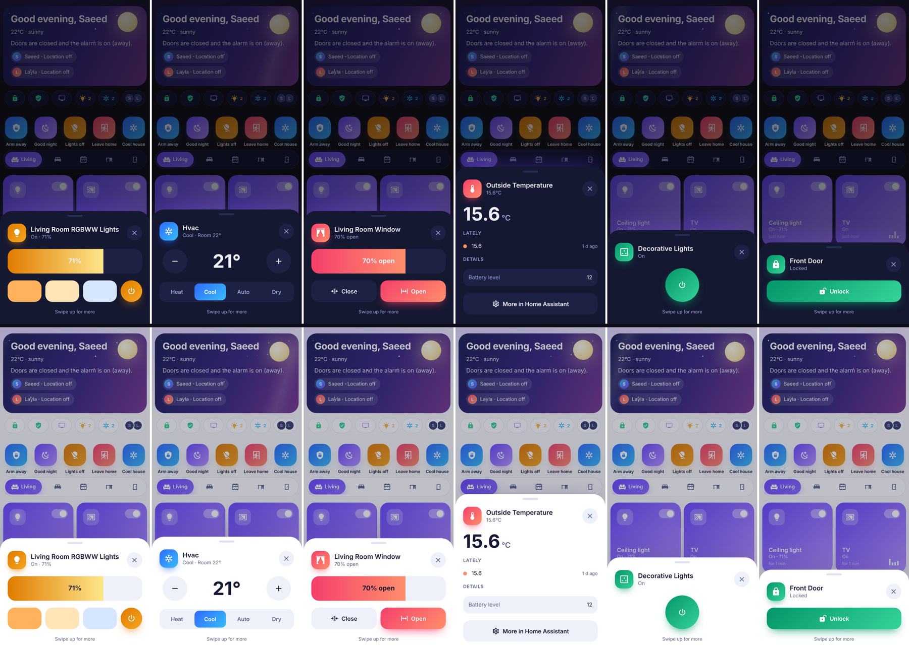

Every kind of device has its sheet: lights, ACs, curtains and garage doors, plugs and fans, sensors, locks, TVs, cameras, the alarm, robot vacuums, water heaters, people, weather, lists and numbers. Holding a room card opens the room's sheet: one bar for its lights and its devices as small tiles.

To keep Home Assistant's own window on a card: `details: home-assistant`.
# Every card and its settings

Everything below can also be set in the **visual editor** (tap a card while editing the dashboard). The YAML is here for people who like to copy and paste.


Edit a dashboard, tap **Add card**, and search for **Roost**. Choose a card, then set it up in the editor.

Every card's settings follow the same layout: **Start from** (Simple or Detailed), **Device**, **Look**, the card's own parts, **More look settings**, **What it shows**, **Tap and hold**, and **More** (closed). Under **Look** you pick by sight:
- **Style**: small live pictures of each style the card has (curtain kinds, thermostat dials, clock faces and more).
- **Colour**: a dot for each colour (Blue, Purple, Coral, Green, Amber, Teal, Pink, Slate), the rainbow dot for **My own colours** (pick two colours for the gradient under More look settings), and the bulb dot for the light's own colour.
- **Light or dark**: **Auto** (follow Home Assistant), **Light** or **Dark**.
- **Size** and **corner roundness** (on tiles, scenes and the thermostat).
- **Look when on** (tiles and scenes): colour fade, one colour, see-through glass, or a coloured outline only. **Glow**: soft, strong or none.
- **Icon box** (tiles): rounded square, circle, square, or no box. Icon size and name size are sliders.
- **See-through (frosted glass)**, on every card: solid, frosted glass or fully clear, with sliders for how see-through it is and how strong the blur is. On the nav bar the same sliders tune its frosted glass.

```yaml
surface: frosted   # solid, frosted or clear
opacity: 55        # 0 = fully see-through, 100 = solid
blur: 18           # blur behind the card, in pixels
```

**Not working right now**, on every device card: when something is broken, write why, and a calm note covers that card so nobody keeps tapping it. Empty it again when it works.

```yaml
out_of_order: The curtain remote's battery is dead
```

### Roost Tile
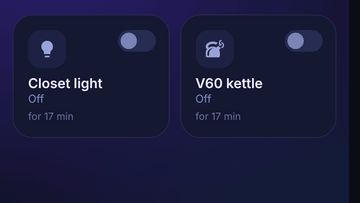 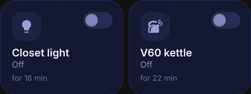

```yaml
type: custom:roost-tile
entity: light.kitchen
name: Kitchen          # optional
icon: mdi:ceiling-light # optional
color: amber           # or "custom" with color_start / color_end
size: large            # compact (short, for wall panels), small, medium or large
radius: 22             # corner roundness in px
animation: auto        # auto, none, glow, spin, pulse, bounce, wiggle or bars
fill: gradient         # gradient, solid, glass or outline
glow: soft             # soft, strong or none
icon_shape: rounded    # rounded, circle, square or none
icon_size: 22          # px
name_size: 15          # px
align: left            # left or center
off_tint: false        # true: a hint of the colour when off
show_state: true       # "On · 78%"
problem: ""            # e.g. "Not working · battery" greys the tile out
quick: switch          # switch (a switch in the corner; tap the tile to switch),
                       # button (a round button in the corner switches; tap the tile for all its controls, like Homey) or none
entities: [light.ceiling, light.lamp]   # optional group: they switch together, the tile says “2 of 3 on · 70%”
stale_hours: 24        # optional: “Not seen for 2 days” when the device stops reporting (often a flat battery)
show_since: true       # "for 5 min"
power_entity: sensor.kitchen_power   # optional
locked: false          # true: no switch, shows a lock (for things that must stay on)
confirm: false         # true: asks before switching (for things that affect many devices)
tap_action: { action: toggle }
hold_action: { action: more-info }
```

### Roost Chips
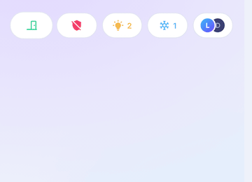 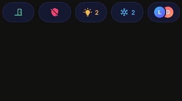

```yaml
type: custom:roost-chips
entities:
  - binary_sensor.front_door
  - alarm_control_panel.home
  - climate.living_room
  - light.kitchen        # all lights become one bulb with a count
  - light.hall
  - person.sam           # all people become bubbles
  - person.ali
size: medium             # small, medium or large
align: stretch           # stretch (one row, equal sizes; default), center or start
chip_shape: pill      # pill, rounded or square
background: solid     # solid, glass or none
show_theme: true        # a light and dark mode chip
show_fullscreen: true   # a full screen chip
```

### Roost Thermostat
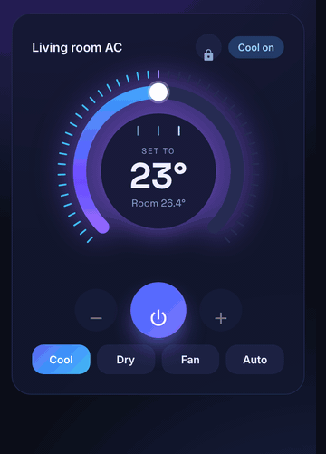 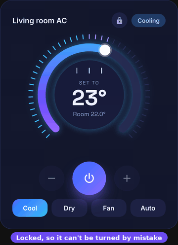

```yaml
type: custom:roost-thermostat
entity: climate.living_room
sensor: sensor.living_room_temperature   # optional, shows "Room 27.5°"
style: nest              # nest (like the phone dashboard: glows, with a breeze while it runs) or classic
color: blue              # classic only
modes: [cool, dry, fan_only, heat_cool]
show_power: true
show_plus_minus: true
max_width: 250           # dial size in px
compact: false           # true: the power and +/- buttons sit in the gap of the dial, for wall panels
power_action:            # optional: for an AC sent by infrared, the power button runs your script
  action: perform-action
  perform_action: script.turn_on
  target: { entity_id: script.bedroom_ac_power }
lock: temp               # temp: the dial and +/- need a tap on the lock first; all: every button does; off
relock: 10               # seconds before it locks itself again
```
Drag the knob or tap anywhere on the ring. The number follows your finger, and the temperature is sent when you let go.

### Roost Scene
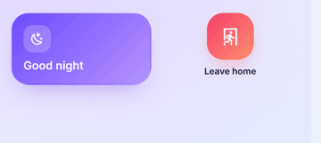 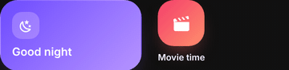

```yaml
type: custom:roost-scene
entity: scene.movie_night
color: purple
style: card              # card, or round (round button with the name under it)
size: large
shape: rounded        # round style: rounded, circle or square
button_size: 58       # round style, px
fill: gradient        # gradient, solid, glass or outline
show_name: true
```

### Roost Scenes
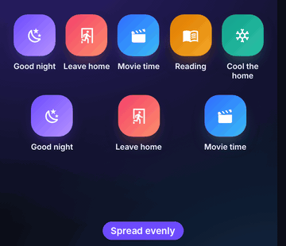 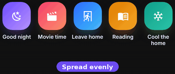

All your scenes as round buttons in one card. **Spread** keeps them evenly spaced and centred, however many there are, and long names wrap under their own button. **Stacked** overlaps them like a dock: the button under your finger lifts and shows its name, and letting go runs it.

```yaml
type: custom:roost-scenes
layout: spread          # spread, or stack
show_names: true        # spread only; stacked buttons show their name when touched
button_size: 58
shape: rounded          # rounded, circle or square
fill: gradient          # gradient, solid, glass or outline
items:
  - { name: Good night, icon: mdi:weather-night, entity: scene.good_night, color: purple }
  - { name: Movie time, icon: mdi:movie-open, entity: scene.movie_time, color: blue }
  - { name: Leave home, icon: mdi:exit-run, entity: script.leave_home, color: coral }
```

### Roost Top Bar
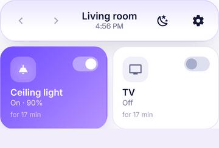 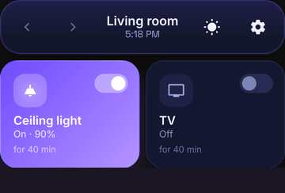

A bar at the top of the screen in the same frosted glass as the bottom bar: back and forward buttons, the page's name (or your own title), the time, and your own buttons on the right (a page, full screen, light and dark, or Arabic and English).

```yaml
type: custom:roost-top-bar
show_back: true
show_forward: true
title: ""               # empty: the page's own name
show_clock: true
fixed: true             # stays at the top while the page scrolls
items:
  - { action: theme }                       # light and dark (its icon follows)
  - { icon: mdi:cog, name: Settings, path: /config/dashboard }
```

Like the bottom bar, the top bar on every page looks like the one on your dashboard's first page. Turn on **Its own look** to style one bar separately.

### Roost Hero
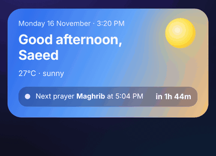 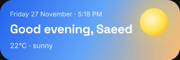

```yaml
type: custom:roost-hero
weather: weather.home
title: Sam               # optional; otherwise the signed-in person's first name
show_clock: true
show_date: true
sky: auto                # auto (follows the sun), or any colour
upcoming_title: Next prayer
upcoming:                # the soonest of these times is counted down
  - { name: Fajr, entity: sensor.fajr_prayer }
  - { name: Maghrib, entity: sensor.maghrib_prayer }
show_orb: true
show_stars: true
show_sheen: true
min_height: 180
greeting: ""             # empty = Good morning / afternoon / evening
show_greeting: true
show_name: true
greeting_size: 27
align: left             # left or center
show_weather: true
info:                   # small readings under the weather
  - entity: sensor.inside_temperature
    name: Inside
sky: auto               # auto, day, night, sunrise, sunset, ocean, aurora, desert, a colour or custom
orb_size: 56
pill_style: glass       # glass, light or none
tap_action: { action: none }
```

### Roost Row
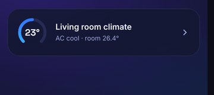 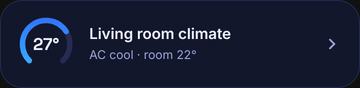

```yaml
type: custom:roost-row
entity: climate.living_room
name: Living Room climate
color: blue              # ring colour
min: 16                  # for sensors: where the ring starts and is full
max: 30
tap_action: { action: navigate, navigation_path: "#living" }
ring_size: 64
ring_width: 6
```

### Roost Nav
 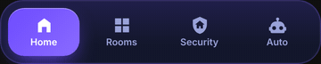

A button can open another page (`/dashboard-home/rooms`) or jump down the same page (`#rooms`). A `#rooms` button scrolls to the Roost Title called "Rooms" (or the one whose **Jump name** is `rooms`); if there is none, it goes back to the top.

```yaml
type: custom:roost-nav
layout: auto             # auto (bar on phones, rail on tablets), bar or rail
show_labels: false       # icons only, or names under the icons
fixed: true              # stick to the bottom (bar) or the side (rail)
items:
  - { icon: mdi:home, path: "#home", name: Home }
  - { icon: mdi:view-grid, path: "#rooms", name: Rooms }
  - { icon: mdi:shield-home, path: /lovelace/security, name: Security }
show_labels: true     # names under the icons
active_style: filled  # filled, soft, pill, line, dot or icon
background: glass     # glass, solid or none
bar_height: 54
icon_size: 22
own_look: false       # the bar on every page looks like the one on the dashboard's first page; true keeps this one's own
# a button that switches full screen on and off (its icon follows); put it on the side rail, only for you:
#  - { name: Full screen, icon: mdi:fullscreen, action: fullscreen, bottom: true, users: [person.me] }
```

### Roost Rooms Selector
 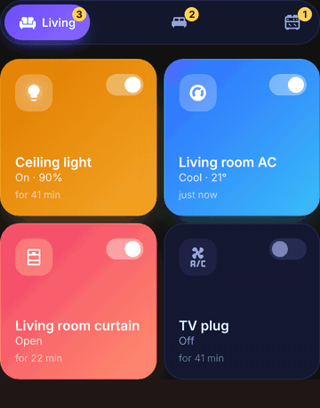

**No code needed:** in the card's editor, under **Cards in each room**, tap a room, then use **+** to add any card (Roost or Home Assistant's own), the arrows to move it, and the bin to remove it. The number on each room button says how many cards it has.

```yaml
type: custom:roost-rooms
rooms:
  - name: Living
    icon: mdi:sofa
    color: teal            # optional, this room's button colour
    entities:              # each device becomes a tile, coloured by type
      - light.living
      - climate.living_ac
      - cover.living_curtain
    cards:                 # optional extra cards
      - type: custom:roost-row
        entity: climate.living_ac
        wide: true
  - name: Bedroom
    icon: mdi:bed-king
    link: "#bedroom"        # opens from a link: a side-rail button, a Room card's tap, any "navigate"
    entities: [light.bedroom]
    cards:
      - { type: custom:roost-thermostat, entity: climate.bedroom_ac, span: 2 }   # span: takes two columns
  - name: Automations
    icon: mdi:robot
    link: "#automations"
    hidden: true            # no button in the bar: reached only from its link (for example the side rail)
    cards:
      - { type: custom:roost-automations, wide: true }
show_names: active         # active (icons, name on the chosen room), all (icons and names), names (names only) or none (icons only)
pill_align: fill           # fill (same width, filling the bar), spread, start or center
pill_width: 0              # button width in px, 0 = automatic
pill_shape: pill           # pill, rounded or square
pill_height: 44
pill_icon_size: 22
pill_align: spread         # spread, start or center
show_count: false          # badge: how many things are on
active_style: filled       # filled, soft or line
background: solid          # solid, glass or none
columns: 2
gap: 12
tile_size: large
tile_fill: gradient
tile_glow: soft
tile_radius: 22
auto_colors: true
swipe: true
remember: true
start_room: ""
follow: false              # Follow me: open the room you are in
follow_tracker: ""         # or a Bluetooth room tracker, e.g. sensor.my_phone_area (Bermuda)
follow_pause: 2            # minutes to wait after you pick a room yourself
# per room: presence: binary_sensor.kitchen_presence (empty = any presence or motion sensor
# in the Home Assistant area with the room's name), area: kitchen (if the area's name is different)
```

### Roost Curtain
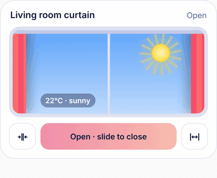 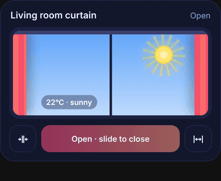

Looks: `look: banded` gives ripple folds with a band along the hem (`band: silver`, `band_height: 22`). For your own fabric, put a picture of it in Home Assistant's `www` folder and use `fabric_image: /local/roost/fabric.jpg`: the card adds the folds (`photo_folds: false` if the picture already shows folds) and, with `photo_band: true`, the bottom band. One curtain that opens from right to left: `style: left`.

**Curtain box:** `box: gypsum` (a plain gypsum box), `cornice` (with a cornice), `light` (with a hidden light strip), `fabric` (a fabric pelmet, `box_fabric: linen` and `box_shape: scallop` for a scalloped edge) or `wood`.

**Gypsum colour:** `box_color` paints the gypsum, cornice and light-strip boxes to match your ceiling: ceiling white (default), a ready colour from the list (warm white, ivory, beige, sand, light grey, grey, charcoal, black, sage, sky) or your own, like `box_color: "#EDE3D1"`.

Drag sideways on the window to slide the curtains open or closed (up and down for a blind). With `reverse: true` every control is turned around for you: buttons, slide bar, tapping the window and the details sheet.

```yaml
type: custom:roost-curtain
entity: cover.living_room
name: Curtains          # optional
color: coral            # fabric colour
style: pair             # pair, left, right or blind
height: 150
radius: 18
travel_time: 1.4        # seconds the slide takes on screen
background: sky         # sky, weather, picture or none
weather: weather.home   # for background: weather
image: /local/view.jpg  # for background: picture
image_night: ""         # optional night picture
show_weather_text: true
show_header: true
show_buttons: true
show_percent: true
reverse: false          # true: the curtain reports open/closed the wrong way round
tap_action: { action: toggle }
stop_action:            # optional: what Stop does as well as stopping the curtain
  action: perform-action
  perform_action: script.turn_on
  target: { entity_id: script.curtain_stop }
```

**Real-looking curtains and blinds.** Pick a look and a fabric or finish in the editor (*Look*):
```yaml
look: pleat          # classic, pleat (pinch pleat drapes on a rod), wave (wave curtain on rings) or sheer (sheer behind a blackout)
blind_look: venetian # for style: blind: classic, venetian (slats that tilt), roller (rolls into a tube) or roman (soft folds)
fabric: linen        # linen, sand, sage, navy, charcoal, blush, white, oak, walnut, grey, black (empty = the card colour)
controls: slider     # slider (one slide bar and two arrows), buttons (Open, Stop, Close) or none
```
Drag the slide bar to send it to any position; tap the bar while it moves to stop it. Venetian slats tilt with the blind's tilt position.

| Pleat | Wave | Sheer |
|:-:|:-:|:-:|
| 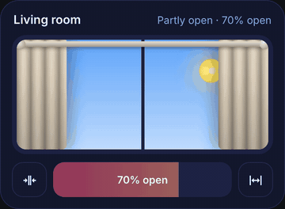 | 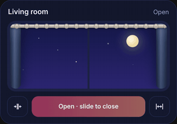 | 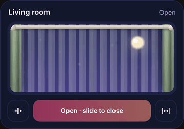 |


| Venetian | Roller | Roman |
|:-:|:-:|:-:|
| 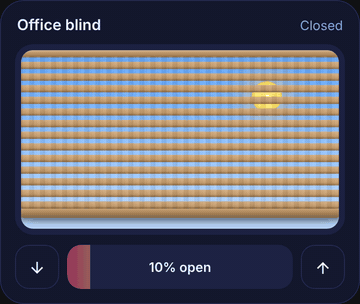 | 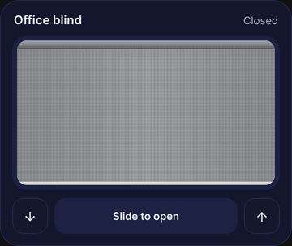 | 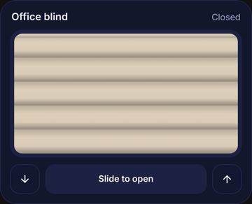 |

**Opens with the sun**
```yaml
open_at: sunrise     # or "06:30"
close_at: sunset     # or "22:00"
schedule: automation.curtains_with_the_sun   # the card shows the times and turns it on or off
```

### Roost Gauge
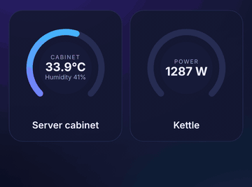 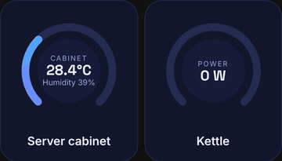

```yaml
type: custom:roost-gauge
entity: sensor.cabinet_temperature
title: Cabinet           # small word in the ring
min: 20
max: 45
warn: 32                 # orange from here (warn_below for too low)
second: sensor.cabinet_humidity
second_name: Humidity
```

### Roost Graph
 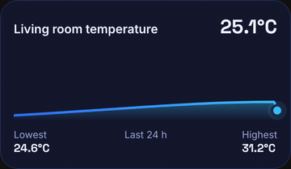

```yaml
type: custom:roost-graph
entity: sensor.plug_power
hours: 24
color: blue
height: 90
```

### Roost Room
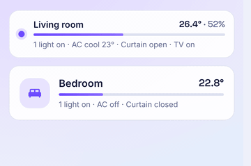 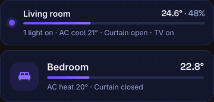

```yaml
type: custom:roost-room
name: Living room
temperature: sensor.living_temperature
humidity: sensor.living_humidity
entities: [light.living, climate.living_ac, cover.living_curtain, media_player.tv]
style: row               # row, card, or tile (the big coloured tile of the Rooms page)
subtitle: TV off · curtain open   # optional: your own line instead of the automatic one
tap_action: { action: navigate, navigation_path: "#living" }
light_slider: true       # one slider for every light in the room (slim row and card)
```
When the room has a motion or presence sensor in `entities`, the line says “Someone here” (and which sensor, when there are several) with a soft pulsing dot, or “Empty · movement 12 min ago”.

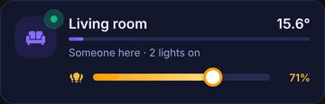

A group tile with the round button:

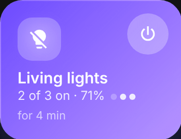

**Cards under the room** — any card, Roost or Home Assistant's own:

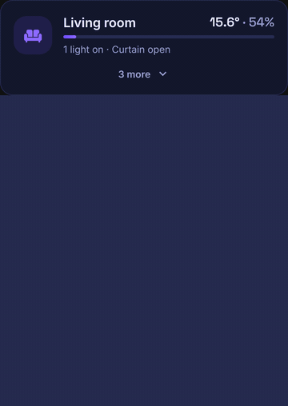

```yaml
cards_look: inside      # inside (one box with the room) or below
cards_columns: 2        # cards side by side (one on narrow phones)
cards_fold: true        # folded away behind “3 more” until tapped
cards:
  - { type: custom:roost-tile, entity: light.living_lamp }
  - { type: custom:roost-curtain, entity: cover.living_curtain }
  - { type: tile, entity: climate.living_ac }    # Home Assistant's own cards work too
```
In the visual editor the cards are added under **Cards on it**, the same way as in a Roost Panel.

**The big room tile** (`style: tile`) can be laid out your way:

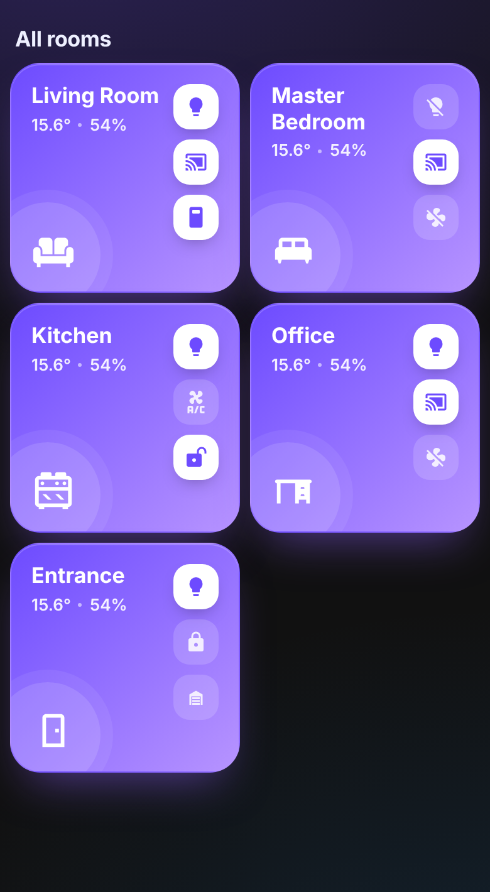

```yaml
style: tile
tile_color: active        # always, active (only when something is on) or never
fill: gradient            # gradient, solid, glass or outline
glow: soft                # soft, strong or none
icon_position: bottom-right   # top-left, top-right, bottom-left or bottom-right
icon_shape: circle        # rounded, circle or none
icon_size: 42
badge: count              # activity (green dot), count (devices on) or none
temp_position: top-left   # any corner, or hidden
show_humidity: true
temp_bar: bottom          # none, bottom, top or side
show_summary: true
show_ago: false           # hide “for 3 min”
name_size: 15
temp_size: 17
height: 170
background_image: /local/rooms/living.jpg
image_dim: 45
hold_action: { action: more-info, entity: climate.living_ac }
# Quick buttons: tap starts it, hold shows its details
buttons_entities: [light.living, scene.movie_time, automation.cool_down, script.bedtime]
buttons_auto: true        # or use the room's own devices
buttons_max: 3
buttons_position: top-right   # any corner, or row (under the name)
button_size: 34
```
Each quick button can also have its own actions: `buttons: [{ entity: light.living, icon: mdi:lamp, hold_action: { action: more-info } }]`. Automations are run, scripts and scenes started, buttons pressed, locks locked or unlocked, and everything else switched on or off.

The slim row can show small device icons instead of the temperature bar: `bar: devices` (or `bar: none`).

### Roost Light
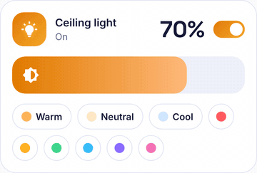 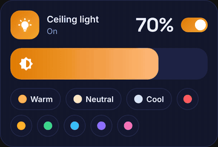

```yaml
type: custom:roost-light
entity: light.desk_lamp
show_presets: true       # warm / neutral / cool
show_colors: true
```

### Roost Media
 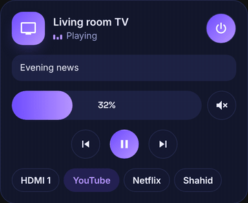

```yaml
type: custom:roost-media
entity: media_player.living_room_tv
volume_entity: media_player.soundbar   # optional
power_entity: switch.tv_plug           # optional
max_sources: 6
```

### Roost Alarm
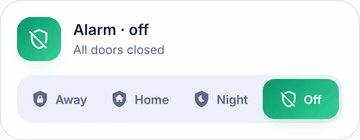 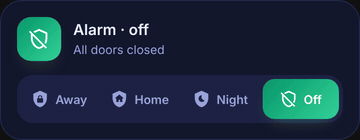

```yaml
type: custom:roost-alarm
entity: alarm_control_panel.alarmo
modes: [arm_away, arm_home, arm_night]
doors: [binary_sensor.front_door]
confirm: true
style: card             # card (compact, default), big (large shield) or pills
show_doors: false       # list the doors under the switch
```

### Roost People
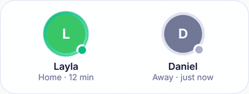 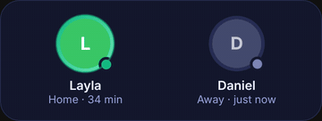

```yaml
type: custom:roost-people
entities: [person.saeed, person.layla]
layout: row              # row or list
```

### Roost Automations
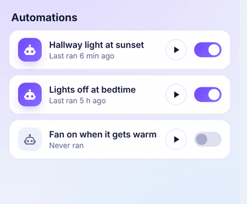 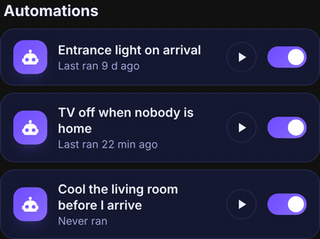

```yaml
type: custom:roost-automations
title: Automations
entities: [automation.entrance_light, automation.tv_off]
all: false               # true: every automation
show_run: true
```

### Roost Clock
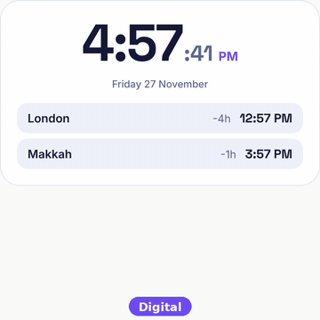 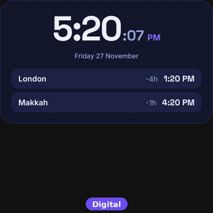

A clock and nothing else, with eight faces: **digital, analog, minimal, flip, ring, words, neon and LCD**.

```yaml
type: custom:roost-clock
face: analog              # digital, analog, minimal, flip, ring, word, neon, lcd
seconds: true
hour24: false
date_format: long         # long, short, numeric, none
show_hijri: true
timezone: Asia/Riyadh     # optional: another place
label: Makkah             # optional
numerals: western         # western, eastern (١٢٣), roman, none (analog faces)
ticks: hours              # hours, all, none
hands: classic            # classic, slim, bold
smooth: true              # sweeping second hand
size: large               # small, medium, large, huge
world:                    # optional: world clocks underneath
  - { label: London, timezone: Europe/London }
line: sky                 # the line of times: sky (colours of the day) or plain
# times marked countdown: true are the only ones counted down to (for example the prayers, not sunrise)
```

### Roost Prayer Times
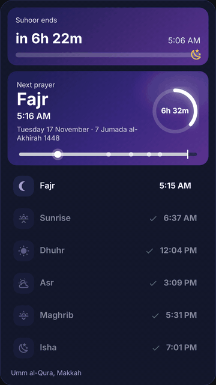 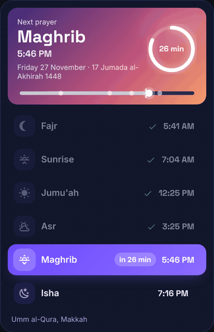

Today's prayer times, the next one with a countdown ring, a line of the day and the Hijri date.
The times can be **calculated on the spot** (no internet needed), fetched **online** (aladhan.com), or read from **your own sensors**.

```yaml
type: custom:roost-prayer
source: calculate         # calculate, online, sensors
method: makkah            # makkah, mwl, isna, egypt, karachi, gulf, kuwait, qatar, dubai, jafari, tehran, singapore, turkey, france, russia
asr: standard             # standard or hanafi
adjust: { fajr: 2, isha: -1 }   # move a time by minutes
prayers: [fajr, sunrise, dhuhr, asr, maghrib, isha]   # also imsak, midnight, last_third
layout: list              # list, tiles, compact
names: english            # english, arabic, both
numerals: western         # western or eastern (١٢٣)
show_hijri: true
hijri_offset: 0           # correct the Hijri day by ±1 or 2
jumuah: true              # "Jumu'ah" instead of Dhuhr on Fridays
# Your own calendar (for example the Al-Hadi calendar): any time can come from your own sensor,
# the rest is calculated.
source: sensors
calendar_name: Al-Hadi calendar
imsak_entity: sensor.my_calendar_imsak
fajr_entity: sensor.my_calendar_fajr
dhuhr_entity: sensor.islamic_prayer_times_dhuhr_prayer
```

**Adhan and Ramadan**
```yaml
adhan_speaker: media_player.living_room
adhan_media: /local/adhan.mp3
adhan_switches: [input_boolean.adhan_fajr, input_boolean.adhan_dhuhr, input_boolean.adhan_asr, input_boolean.adhan_maghrib, input_boolean.adhan_isha]
ramadan: auto        # auto (in Ramadan), on or off: shows “Suhoor ends in …” and “Iftar in …”
```
Each prayer row gets a bell that turns its switch on or off. Play the adhan with an automation like this one (one per prayer, or use a template):
```yaml
triggers:
  - trigger: time
    at: sensor.fajr_prayer          # your prayer time sensor
conditions:
  - condition: state
    entity_id: input_boolean.adhan_fajr
    state: "on"
actions:
  - action: media_player.play_media
    target: { entity_id: media_player.living_room }
    data: { media_content_id: /local/adhan.mp3, media_content_type: music }
```
Your home's location is used unless you set `latitude` and `longitude`.

### Roost Alerts
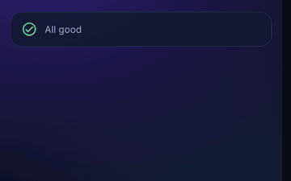 

```yaml
type: custom:roost-alerts
batteries: true
battery_below: 20
offline: [sensor.living_temperature]
doors: [binary_sensor.front_door]
door_minutes: 10
rules:
  - { entity: sensor.cabinet_temperature, above: 32, message: Server cabinet too hot }
```

### Roost Title and Roost Light/Dark
   

```yaml
type: custom:roost-title
title: Devices
temperature: sensor.living_temperature   # optional: shows "22.8°C · 52% humidity" under the title
humidity: sensor.living_humidity
link_text: See all
back: "#rooms"           # optional: a back button (a page, or "back")
tap_action: { action: navigate, navigation_path: "#devices" }
---
type: custom:roost-theme
show_label: true
entity: input_boolean.dashboard_dark_mode   # optional: switched on in dark, off in light, for automations or other screens
```

### Roost Remote


```yaml
type: custom:roost-remote
athom_remote: Living room TV    # an Athom Hub remote's name
# or: entity: remote.living_room_tv   /   entity: media_player.tv
# or: buttons: [button.tv_power, button.tv_up, button.tv_ok]
pad_style: buttons      # buttons (round pad) or touchpad (swipe to move, tap for OK, hold for Back)
show_pad: true
show_extra: true        # back, home, menu, input
show_volume: true       # volume and channel rockers
show_media: false       # rewind, previous, play/pause, next, fast forward
show_colors: false      # red, green, yellow, blue keys
show_numbers: false
key_size: 56
shortcuts:              # your own buttons on top: apps, scenes, scripts
  - name: Netflix
    icon: mdi:netflix
    color: coral
    tap_action: { action: perform-action, perform_action: script.tv_netflix }
actions:                # optional: what a key does instead (YAML only)
  ok: { action: perform-action, perform_action: remote.send_command, target: { entity_id: remote.tv }, data: { command: select } }
```

### Roost Air


```yaml
type: custom:roost-air
entity: fan.air_purifier        # optional: the purifier (on/off, mode, speed)
air: sensor.living_room_pm25    # PM2.5, an air quality index or CO₂
scale: auto                     # auto, pm25, aqi or co2
filter: sensor.purifier_filter_life
temperature: sensor.living_room_temperature
humidity: sensor.living_room_humidity
```

### Roost Water Heater


```yaml
type: custom:roost-water-heater
entity: water_heater.boiler     # or a switch, with temperature: sensor.boiler_water
timer: timer.boiler             # optional: “heat for” starts this timer; an automation turns the heater off when it ends
boost: [30, 60]                 # the “heat for” buttons, in minutes
```

### Roost Doorbell


```yaml
type: custom:roost-doorbell
camera: camera.front_door
ring: binary_sensor.doorbell    # or event.doorbell
motion: binary_sensor.front_door_person   # optional
lock: lock.front_door           # optional: tap twice to unlock
```

### Roost Laundry


```yaml
type: custom:roost-laundry
kind: washer                    # washer, dryer or dishwasher
entity: sensor.washer_state     # its state, a power reading (with power_on: 5) or a switch
remaining: sensor.washer_time_left   # minutes left, or the finish time
progress: sensor.washer_progress
stage: sensor.washer_stage      # wash, rinse, spin…
```

### Roost Garage


```yaml
type: custom:roost-garage
entity: cover.garage_door       # or a switch / button with sensor: binary_sensor.garage_open
style: garage                   # garage, gate (slides) or swing (two wings)
warn_after: 10                  # minutes open before it turns red
```

**Real-looking garage doors:**
```yaml
door: sectional      # classic, sectional (panels with a row of windows) or shutter (aluminium roller shutter)
finish: white        # white, anthracite, oak, silver, walnut or sand
```
The door rolls up into the wall and the car shows behind it.

| Sectional | Shutter |
|:-:|:-:|
|  |  |

### Roost Energy Flow


```yaml
type: custom:roost-flow
solar: sensor.solar_power
home: sensor.house_power
grid: sensor.grid_power         # + buying, − selling (grid_invert: true if yours is the other way)
battery: sensor.battery_power   # + giving, − charging (battery_invert: true if the other way)
battery_level: sensor.battery_level
```

**Electricity bill** (needs the daily energy reading)
```yaml
price: 0.016         # per kWh, or stepped prices:
tiers:
  - { upto: 3000, price: 0.003 }
  - { upto: 5000, price: 0.009 }
  - { price: 0.016 }
currency: BD
budget: 25           # optional: warns when the month is heading over it
```

### Roost Irrigation


```yaml
type: custom:roost-irrigation
minutes: 10                     # tap a zone to water it this long
timer: timer.garden             # optional: an automation closes the valve when it ends
rain: sensor.rain_today         # mm, or a rain sensor: “no need to water today”
zones:
  - { entity: valve.front_lawn, name: Front lawn, icon: mdi:grass }
  - { entity: switch.flower_beds, name: Flower beds, icon: mdi:flower-tulip }
```

### Roost Car


```yaml
type: custom:roost-ev
battery: sensor.car_battery
range: sensor.car_range
power: sensor.charger_power
charging: switch.car_charging   # a switch shows Start / Stop charging
plugged: binary_sensor.car_plugged_in
limit: number.car_charge_limit
capacity: 64                    # battery size in kWh, for “full in”
image: /local/my-car.png        # optional: your own car from the side instead of the drawing
```

### Roost Plant


```yaml
type: custom:roost-plant
name: Monstera
moisture: sensor.monstera_moisture
light: sensor.monstera_illuminance
temperature: sensor.monstera_temperature
conductivity: sensor.monstera_conductivity
min_moisture: 20
```

**Three looks with a lifelike monstera** (its leaves droop and turn yellow when it is thirsty):
```yaml
look: portrait       # classic, portrait (the plant and each reading's good range), ring (one ring per need and a score) or pot (see inside the pot)
```

| Portrait | Ring | Pot |
|:-:|:-:|:-:|
|  |  |  |

### Roost Printer


```yaml
type: custom:roost-printer
kind: ink                       # ink (paper printer) or 3d
entity: sensor.printer_status
inks:
  - { entity: sensor.printer_black, color: "#1F2333" }
  - { entity: sensor.printer_cyan, color: "#22D3EE" }
# 3D printer: progress, remaining, nozzle, bed, camera
```

### Roost Moments


```yaml
type: custom:roost-moments
moments:
  - { name: Morning, icon: mdi:weather-sunset-up, from: "05:30", entity: scene.morning }
  - { name: Evening, icon: mdi:weather-sunset-down, from: "17:30", entity: scene.evening }
  - { name: Bedtime, icon: mdi:weather-night, from: "22:00", entity: scene.good_night }
```

### Roost Family Map


Nothing leaves the house: there are no map pictures, only home, your places and the people.
```yaml
type: custom:roost-family
entities: [person.saeed, person.layla, person.daniel]
zones: [zone.work, zone.school]
```

### Roost Popup


Put the Popup card anywhere on the dashboard. It is invisible, and shows only while you edit (with a **Show it** button to try it). On a phone it rises from the bottom; on a tablet it sits in the middle.

```yaml
type: custom:roost-popup
id: doorbell                     # its short name: the link is #popup-doorbell
kind: camera                     # alert, camera, info or cards
title: Someone is at the door
icon: mdi:doorbell-video
camera: camera.front_door        # a picture every 2 seconds, or live: true for video
entity: lock.front_door          # its state shows under the title
message: The front door is {{state}}.
open_on:                         # opens by itself when...
  - entity: binary_sensor.doorbell
    state: "on"                  # or above: / below: for numbers
close_when_back: true            # ...and closes when the bell stops
close_after: 60                  # or after 60 seconds (a thin bar shows the time left)
users: [person.saeed]            # only on these people's screens (empty = everyone)
sound: /local/chime.mp3          # optional
buttons:                         # up to 4; a button with a colour is the main one
  - name: Open the door
    icon: mdi:lock-open-variant
    color: green
    tap_action: { action: perform-action, perform_action: lock.unlock, target: { entity_id: lock.front_door } }
  - name: Dismiss
```

**Kinds:** *alert* (a warning, red), *camera* (doorbell or someone outside), *info* (a plain message), *cards* (any cards inside, such as a room or a remote; add them under **Cards on it**).

**Ways to open it:**
- by itself, with **open_on** (the doorbell rings, a door opens, a leak, the washing machine finishes, the cabinet gets too hot);
- from any card's tap: `tap_action: { action: navigate, navigation_path: "#popup-doorbell" }`, or `{ action: fire-dom-event, roost_popup: doorbell }`;
- from an automation (people with admin rights): fire the event `roost_popup`:
  ```yaml
  - event: roost_popup
    event_data: { id: doorbell }          # a popup on the dashboard, or a whole one:
    # event_data: { title: Washing done, message: Time to hang the clothes, icon: mdi:washing-machine, color: teal, close_after: 120 }
  ```
- from an automation, for everyone: make a text helper called `input_text.roost_popup` and set it to a popup's id (or to `close`).

**Every “Are you sure?”** on a Roost card (any action with `confirmation:`) now uses this popup instead of the browser's grey box.

### Roost Grocy


Needs the [Grocy integration](https://github.com/custom-components/grocy) (from HACS). Its sensors are off at first: turn them on in **Settings → Devices & services → Grocy → entities**. With their usual names the card finds them by itself:

```yaml
type: custom:roost-grocy
name: Kitchen
tabs: [fridge, shopping, chores, tasks, meals]   # what to show, in this order
soon: 5                 # “goes off soon” means within 5 days
# only if your sensors have other names:
# stock: sensor.grocy_stock
# shopping: sensor.grocy_shopping_list
# chores: sensor.grocy_chores
# tasks: sensor.grocy_tasks
# meals: sensor.grocy_meal_plan
# expiring / expired / missing: binary_sensor.grocy_..._products
done_by: 1              # optional: the Grocy user who does the chores
list_id: 1              # optional: which shopping list
```
- **Fridge**: what goes off soonest first. Tap one for *Used one*, *Opened one* or *Went off, throw away*. *Running low · add to the shopping list* adds what is missing.
- **Shopping**: tap to tick it off (it leaves the Grocy list).
- **Chores** and **Tasks**: tap twice to mark done.
- **Meals**: today, tomorrow and the next days from the meal plan.

### Roost Tank


```yaml
type: custom:roost-tank
kind: water                     # water, gas (LPG) or diesel
level: sensor.roof_tank_level   # % or litres
capacity: 2000                  # litres (or kg for gas)
used_today: sensor.water_used_today
daily_use: sensor.water_average_per_day   # or per_day: 420
leak: binary_sensor.tank_leak
pump: switch.water_pump
low: 20                         # warn below this %
```

### Roost Pool


```yaml
type: custom:roost-pool
temperature: sensor.pool_temperature
chlorine: sensor.pool_chlorine  # ppm; 1–3 is good
ph: sensor.pool_ph              # 7.2–7.6 is good
pump: switch.pool_pump
heater: switch.pool_heater
light: light.pool
```

**Three looks and four tile colours:**
```yaml
look: top            # classic, top (from above), side (shallow to deep end) or gauges (water quality)
tiles: blue          # blue, turquoise, slate or white
```

| Top | Side | Gauges |
|:-:|:-:|:-:|
|  |  |  |

### Roost Pet


```yaml
type: custom:roost-pet
name: Luna
pet: cat                        # cat, dog, bird or fish
feeder: button.feeder_feed      # a button, switch or script
food: sensor.feeder_food_level
water: sensor.fountain_water_level
meals: sensor.feeder_meals_today
```

**Three looks:**
```yaml
look: bowls          # classic, bowls (real bowls on a mat), feeder (smart feeder and fountain with today's meals) or portrait (your pet's face and a ring that fills)
meals_per_day: 4     # for the feeder look
```

| Bowls | Feeder | Portrait |
|:-:|:-:|:-:|
|  |  |  |

### Roost Nursery


```yaml
type: custom:roost-nursery
camera: camera.baby
temperature: sensor.nursery_temperature
humidity: sensor.nursery_humidity
sound: sensor.nursery_sound     # dB (crying above loud: 60) or a crying binary sensor
light: light.night_light
music: media_player.nursery_speaker
```

### Roost Network


```yaml
type: custom:roost-network
kind: router                    # router (internet) or server
download: sensor.speedtest_download
upload: sensor.speedtest_upload
ping: sensor.speedtest_ping
clients: sensor.router_devices_online
restart: button.router_restart  # tap twice to restart
# server: cpu, memory, disk, temperature, uptime
```

### Roost Guest Wi-Fi
 

A QR code guests point their phone camera at to join, so nobody has to read the password out. The code is made on the screen; nothing is sent anywhere.
```yaml
type: custom:roost-wifi
ssid: Nest-Guest
password: your-guest-password
security: WPA                 # WPA, WEP or nopass (open)
switch: switch.guest_wifi     # optional: turn the guest network on from the card
clients: sensor.guest_clients # optional: guests connected
show_password: true           # a button that shows the password
show_share: true              # share it, or copy it on a computer
```
Tip: use **Only show this card to these people** (under More) if the password should only show on the family's screens.

### Roost Announce
 

Type a message, tap a ready one, or tap the microphone and say it (where the screen allows), pick the rooms, then **Announce**.
```yaml
type: custom:roost-announce
speakers: [media_player.living_room, media_player.kitchen, assist_satellite.majlis]
tts: tts.home_assistant_cloud  # the voice (Home Assistant Voice devices need none)
quick: |                       # ready messages, one per line
  Dinner is ready
  Time to leave for school
show_mic: true
show_last: true
```

### Roost Kitchen
 

```yaml
type: custom:roost-kitchen
appliances:
  - entity: sensor.oven_state
    name: Oven
    remaining: sensor.oven_time_left   # minutes, a finish time, or a timer
    progress: sensor.oven_progress     # optional
    temperature: sensor.oven_temperature
  - entity: sensor.air_fryer_state     # "done", "ready" or "finished" shows a green Ready
    name: Air fryer
  - entity: switch.coffee_machine
    name: Coffee machine
    start: switch.coffee_machine       # a Start button while it is off
```

### Roost Kids' internet
 

Each device needs an internet switch from your router's integration in Home Assistant (on = allowed). Many routers offer one per device.
```yaml
type: custom:roost-kids
devices:
  - entity: switch.saeed_tablet_internet
    name: Saeed's tablet
    usage: sensor.saeed_tablet_time_online   # optional
  - entity: switch.layla_phone_internet
    name: Layla's phone
    until: input_datetime.layla_paused_until # optional
bedtime: automation.kids_bedtime_internet    # optional
bedtime_text: 9:30 pm to 6:00 am, school nights
confirm: true                                # tap twice to pause
```

### Roost Family notes
 

Tap **+** to write a note; tap a note twice to remove it. The notes live in a to-do list (Settings → Devices & services → Add → **Local to-do** makes one), so every screen shows the same notes.
```yaml
type: custom:roost-notes
entity: todo.family_notes
max: 6
```

### Roost Deliveries
 

```yaml
type: custom:roost-deliveries
entities: [sensor.17track_packages]  # a sensor that lists its parcels, or one sensor per parcel
max: 4
show_delivered: true
```

### Roost Power backup
 

Works with a UPS in Home Assistant, for example through the **Network UPS Tools (NUT)** integration.
```yaml
type: custom:roost-backup
battery: sensor.ups_battery_charge
runtime: sensor.ups_battery_runtime   # seconds or minutes
status: sensor.ups_status             # OL = on mains, OB = on battery
power: sensor.ups_real_power
covered: |
  Router
  Home Assistant
  Cameras
```

### Roost Car, petrol or hybrid
 

```yaml
type: custom:roost-ev
kind: fuel                  # electric (the default) or fuel
fuel: sensor.car_fuel_level
range: sensor.car_range
lock: lock.car_doors        # unlocking asks for a second tap
climate: climate.car        # or a button or script that starts the AC
tracker: device_tracker.car
```

### Roost Batteries


Every battery in the home in one place, lowest first. Nothing to set up: it finds them by itself.
```yaml
type: custom:roost-batteries
low: 20                  # low below this %
show: all                # all (lowest first) or low (only the low ones, with a calm “All good” when none)
max: 8                   # rows before “Show all”
exclude: [sensor.phone_battery]        # leave some out
# or pick them yourself:
# entities: [{ entity: sensor.hall_motion_battery, name: Hallway motion }]
```

### Roost Timeline


What happened at home, newest first: “Front door opened · 5 min ago”, “Layla arrived home”, “Kitchen leak sensor: water found”.
```yaml
type: custom:roost-timeline
hours: 24                # how far back
max: 8                   # rows before “Show more”
show_motion: false       # motion makes many rows in a busy home
# entities: [lock.front_door, binary_sensor.front_door, person.layla]   # empty = people, doors, windows, locks, curtains, alarm and leaks
```

### Roost Values


Your own settings in one card: a number to slide, a choice to tap, a switch, a short text, a date or time, a counter.
```yaml
type: custom:roost-values
name: House settings
entities:
  - input_number.ac_at_night
  - input_select.who_is_visiting
  - { entity: input_boolean.guest_mode, name: Guests, icon: mdi:account-heart }
  - input_text.note_for_the_cleaner
```

### Roost Bins


```yaml
type: custom:roost-bins
bins:
  - { name: General, colour: black, days: [Sunday, Wednesday] }
  - { name: Recycling, colour: blue, days: [Thursday], every: 2, start: "2026-01-01" }
  - { name: Garden, colour: green, entity: sensor.garden_bin_next }   # a date sensor or days to go
```

### Roost Medicine


```yaml
type: custom:roost-medicine
name: Grandma
doses:
  - { name: Vitamin D, time: "08:00", colour: amber, entity: input_boolean.grandma_vitamin_d }
  - { name: Blood pressure, time: "14:00", colour: blue, entity: input_boolean.grandma_bp }
```
Give each dose an input_boolean (and an automation that turns them all off at midnight) so every screen sees the same ticks. Without it, ticks are kept on this screen only.

### Roost Modes


```yaml
type: custom:roost-modes
modes:
  - { name: Home, icon: mdi:home, entity: input_boolean.mode_home }
  - name: Away
    icon: mdi:walk
    entity: input_boolean.mode_away
    checks: [lock.front_door, binary_sensor.kitchen_window, light.living_room]   # should be locked, closed or off
  - { name: Holiday, icon: mdi:airplane, entity: input_boolean.mode_holiday }
  - { name: Guests, icon: mdi:account-multiple, entity: input_boolean.mode_guests, wifi_name: Guest house, wifi_password: your-guest-password }
```
The Wi-Fi code is made on the screen; the password stays in your dashboard and is not sent anywhere.

### Roost Sleep


```yaml
type: custom:roost-sleep
bedtime: "22:30"
alarm: sensor.phone_next_alarm  # the phone's next alarm, or an input_datetime
routine: script.good_night
duration: sensor.sleep_duration
score: sensor.sleep_score
temperature: sensor.bedroom_temperature
```

### Roost Vacuum


Pick the robot and the card finds the rest on the same device by itself: battery, area and time cleaned, error, filter and brushes, water and mop settings, dock buttons and the map.

```yaml
type: custom:roost-vacuum
entity: vacuum.robot
shape: auto            # auto (from the brand), lidar, lidar_rear, flush, round, shark, d_shape or slim
image: /local/robot.png   # optional: your own picture of the robot from above
map: camera.robot_map  # optional: the robot's map (switch with the map button)
rooms:                 # tap rooms, then "Clean 2 rooms"
  - { name: Living room, icon: mdi:sofa, area: living_room }
  - { name: Kitchen, icon: mdi:stove, area: kitchen }
# Older robots without area cleaning: give a room a tap_action (a script or a command) instead of an area.
# Change what was found: battery, area_sensor, time_sensor, error_sensor, consumables, selects, buttons
```
What it shows:
- **Cleaning**: drives in lanes and leaves a clean trail (blue and wet when it mops); brushes and the laser tower turn.
- **Spot clean**: circles round one place. **Going home**: drives to the dock along a dashed line. **Docked**: a lightning bolt while it charges.
- **Paused** and **Needs help** (with what the robot says is wrong). **Find my robot** sends out rings while it beeps.
- One big button (Start, Pause, Resume, Clean 2 rooms), the dock button, and the rest under **⋯**: spot clean, find, stop, dock buttons.
- Small chips for suction, water flow and mop mode. **Care** says if the filter, brushes or mop pad need changing soon; tap it for each part.

For rooms, first map the robot's rooms to Home Assistant areas: Settings → Devices & services → Entities → your vacuum → cog → **Map vacuum segments to areas**.

### Roost Presence Map


```yaml
type: custom:roost-presence
device: 0123456789abcdef        # the presence sensor (pick it in the editor)
range: 6                        # metres
```

### Roost Weather, Energy and Timer
     

```yaml
type: custom:roost-weather
entity: weather.home
forecast: daily                 # daily, hourly or none
---
type: custom:roost-energy
energy: sensor.energy_today      # kWh meter that counts up
devices: [sensor.kettle_power, sensor.tv_power]
---
type: custom:roost-timer
entity: timer.kettle
dial: true          # turn the ring to set the time, then press play
dial_max: 60        # the longest time on the ring, in minutes
presets: [5, 10]    # optional quick-time buttons as well
```

### Roost Fan, Lock, Agenda and To-do
       

```yaml
type: custom:roost-fan
entity: fan.bedroom
style: dial         # dial (beside the name), big (a big square dial like the thermostat) or buttons
temperature: sensor.bedroom_temperature   # optional: shown with the speed
humidity: sensor.bedroom_humidity
---
type: custom:roost-lock
entity: lock.front_door
door: binary_sensor.front_door
---
type: custom:roost-agenda
entities: [calendar.family]
days: 3
highlight: bin, trash
---
type: custom:roost-todo
entity: todo.shopping_list
```

### Roost Camera, Sensors and Buttons
    

```yaml
type: custom:roost-camera
entity: camera.doorbell
doorbell: binary_sensor.doorbell_ring
aspect: 3/4
---
type: custom:roost-sensors
style: line               # line (A), ring (B: a dial with the comfortable part in green), scale (C: one bar from cold to hot), rows (E: short rows for wall panels)
columns: 3
# what it shows: every part can be turned on or off (in the editor: "What it shows", at the top)
show_icon: true
show_name: true
show_comfort: true         # the word: Comfortable, Warm, Dry, Stuffy...
show_graph: true           # a smooth line of the last hours (style A)
show_trend: false          # “↑ 1.4° in 1 h” (off unless you turn it on)
show_range: false          # the lowest and highest, with a dot for now (style A, off unless you turn it on)
show_scale_words: true     # words under the scale (style C)
hours: 24                  # how far back the line goes
color_by: comfort          # comfort (green when comfortable), type (warm for temperature, blue for humidity) or fixed (color: below)
entities:
  - sensor.living_temperature
  - entity: sensor.bedroom_temperature
    name: Bedroom
    hide: [trend, graph]     # hide parts on this reading only: icon, name, comfort, trend, graph, range, scale_words
    comfort_min: 21          # your own comfortable range: below it says Cool, above it Warm
    comfort_max: 25
    min: 15                  # where the ring, scale and row bar start and end
    max: 35
    color: teal              # one colour just for this reading
    above: 30                # turns orange and says High above this
    decimals: 1
---
type: custom:roost-buttons
items:
  - { name: Lights, icon: mdi:lightbulb-group, entity: light.living }
  - { name: Movie, icon: mdi:movie, tap_action: { action: perform-action, perform_action: scene.turn_on, target: { entity_id: scene.movie } } }
active_style: filled  # same choices as the nav bar: filled, soft, pill, line, dot or icon
background: glass     # glass, solid or none
```


### Roost Full Screen
 

```yaml
type: custom:roost-fullscreen
mode: auto                # auto (invisible: full screen by itself) or button
hide_header: true
hide_sidebar: true
users: []                 # auto mode: people who get full screen (empty = everyone)
exit_button: true         # auto mode: a small exit button
exit_users: [person.saeed] # who sees the exit button (empty = everyone)
exit_position: top-right
browser_fullscreen: false # button mode: also hide the browser's own bars
```

Any card can switch full screen with its tap action:
```yaml
tap_action:
  action: fire-dom-event
  roost_fullscreen: toggle   # toggle, on or off
```
Add `?roost_full=off` to the dashboard's address to turn it off on that screen.

### Sample data
Roost Fan, Lock, Camera, Timer and Remote can show pretend devices so you can try them before you own one:
```yaml
type: custom:roost-fan
sample: true
```

### Tablet and wall panel
The tablet look is a **Sections** view with 3 columns: one section 2 columns wide for the main cards, one section for the side cards.
```yaml
type: custom:roost-nav          # the side rail
layout: rail
rail_style: full               # full height, from top to bottom
logo: person.saeed             # a picture at the top (or a letter, like H)
show_labels: false
items:
  - { icon: mdi:home-variant, path: /dashboard-tablet/home, name: Home }
  - { icon: mdi:view-grid, path: /dashboard-tablet/rooms, name: Rooms }
  - { icon: mdi:cog, path: /config/dashboard, name: Settings, bottom: true }
```
```yaml
type: custom:roost-hero
house: true                    # the house picture with lit windows
status_entities: [binary_sensor.front_door, alarm_control_panel.home, person.saeed, person.layla]
people: [person.saeed, person.layla]
```
```yaml
type: custom:roost-clock
face: times                    # big time and the line of prayer times
prayer_method: makkah
countdown_title: Next prayer
```
In **Roost Rooms Selector**, give each room a `temperature` and `humidity` sensor to show them next to the room buttons, and set `columns: 4` for one row of tiles.

### Roost Page
A whole phone page laid out like the original dashboard: 14 px at the sides, 16 px between cards, the night-sky background and room for the bottom bar. Put it in a **Panel** view and list the page's cards in it. Cards that sit side by side go in a `grid` (8 px apart).

> **Easier to edit: use a Sections view instead.** Inside a Roost Page, Home Assistant gives one edit button to the whole page, so every card's settings open stacked in one window. In a normal **Sections** view each card has its own edit button. To keep the Roost look there, set the view to one column and give it the night-sky background:
> ```yaml
> type: sections
> max_columns: 1
> background: >-
>   radial-gradient(1000px 620px at 15% -10%, #2A1F6B 0%, transparent 60%),
>   radial-gradient(800px 600px at 100% 100%, #0E2A4A 0%, transparent 60%), #0B0D17
> sections:
>   - type: grid
>     cards:
>       - type: custom:roost-hero
>         grid_options: { columns: full }
> ```

```yaml
type: custom:roost-page
cards:
  - type: custom:roost-hero
  - type: custom:roost-chips
    entities: [binary_sensor.front_door, alarm_control_panel.home, person.saeed]
  - type: grid
    columns: 2
    square: false
    cards:
      - { type: custom:roost-tile, entity: light.kitchen }
      - { type: custom:roost-tile, entity: switch.kettle }
gap: 16           # space between cards
side: 14          # space at the sides
bottom: 130       # room for the bottom bar
background_image: /local/roost/wall.jpg   # optional: your own picture behind the page; frosted-glass cards blur it
image_dim: 35     # darken the picture (%)
image_blur: 0     # soften the picture
```

### Roost Panel
A rounded box with a title that holds other cards, like the "Rooms" box on the home page.

```yaml
type: custom:roost-panel
title: Rooms
subtitle: Living room · 8 outlets   # optional line under the title
picture: /local/strip.png           # or icon: mdi:power-socket-uk
collapsible: true                   # folds open and closed
columns: 4                          # cards side by side (fewer on a narrow phone); a card with wide: true takes the whole row
entities: [alarm_control_panel.home, binary_sensor.front_door]   # rows with their state
cards:
  - { type: custom:roost-room, name: Kitchen, temperature: sensor.kitchen_temperature, plain: true }
  - { type: custom:roost-room, name: Bedroom, temperature: sensor.bedroom_temperature, plain: true }
```

[← Back to the README](../README.md)
