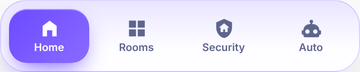
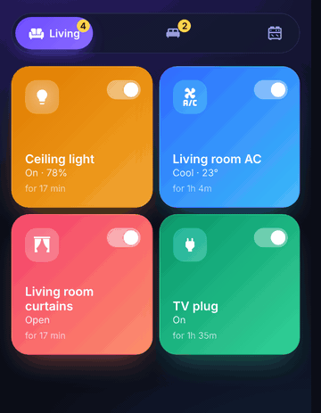
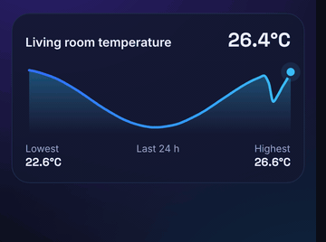
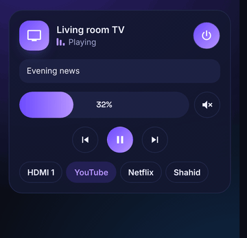
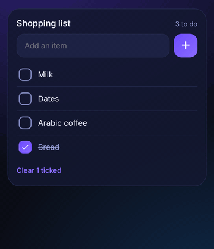
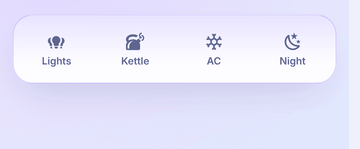

# Every card and its settings

Everything below can also be set in the **visual editor** (tap a card while editing the dashboard). The YAML is here for people who like to copy and paste.


Edit a dashboard, tap **Add card**, and search for **Roost**. Choose a card, then set it up in the editor.

Every card has these colour and look settings:
- **Colour**: Blue, Purple, Coral, Green, Amber, Teal, Pink, Slate, or **My own colours** (pick two colours for the gradient).
- **Light or dark**: follow Home Assistant, always dark, or always light.
- **Size** and **corner roundness** (on tiles, scenes and the thermostat).
- **Look when on** (tiles and scenes): colour fade, one colour, see-through glass, or a coloured outline only. **Glow**: soft, strong or none.
- **Icon box** (tiles): rounded square, circle, square, or no box. Icon size and name size are sliders.
- **See-through (frosted glass)**, on every card: solid, frosted glass or fully clear, with sliders for how see-through it is and how strong the blur is. On the nav bar the same sliders tune its frosted glass.

```yaml
surface: frosted   # solid, frosted or clear
opacity: 55        # 0 = fully see-through, 100 = solid
blur: 18           # blur behind the card, in pixels
```

### Roost Tile


```yaml
type: custom:roost-tile
entity: light.kitchen
name: Kitchen          # optional
icon: mdi:ceiling-light # optional
color: amber           # or "custom" with color_start / color_end
size: large            # small, medium or large
radius: 22             # corner roundness in px
animation: auto        # auto, none, glow, spin, pulse, bounce, wiggle or bars
fill: gradient         # gradient, solid, glass or outline
glow: soft             # soft, strong or none
icon_shape: rounded    # rounded, circle, square or none
icon_size: 22          # px
name_size: 15          # px
align: left            # left or center
off_tint: false        # true: a hint of the colour when off
show_state: true       # "On · 78%"
problem: ""            # e.g. "Not working · battery" greys the tile out
show_switch: true
show_since: true       # "for 5 min"
power_entity: sensor.kitchen_power   # optional
locked: false          # true: no switch, shows a lock (for things that must stay on)
confirm: false         # true: asks before switching (for things that affect many devices)
tap_action: { action: toggle }
hold_action: { action: more-info }
```

### Roost Chips


```yaml
type: custom:roost-chips
entities:
  - binary_sensor.front_door
  - alarm_control_panel.home
  - climate.living_room
  - light.kitchen        # all lights become one bulb with a count
  - light.hall
  - person.sam           # all people become bubbles
  - person.ali
size: medium             # small, medium or large
align: stretch           # stretch (one row, equal sizes; default), center or start
chip_shape: pill      # pill, rounded or square
background: solid     # solid, glass or none
```

### Roost Thermostat


```yaml
type: custom:roost-thermostat
entity: climate.living_room
sensor: sensor.living_room_temperature   # optional, shows "Room 27.5°"
style: nest              # nest (like the phone dashboard: glows, with a breeze while it runs) or classic
color: blue              # classic only
modes: [cool, dry, fan_only, heat_cool]
show_power: true
show_plus_minus: true
max_width: 250           # dial size in px
```
Drag the knob or tap anywhere on the ring. The number follows your finger, and the temperature is sent when you let go.

### Roost Scene


```yaml
type: custom:roost-scene
entity: scene.movie_night
color: purple
style: card              # card, or round (round button with the name under it)
size: large
shape: rounded        # round style: rounded, circle or square
button_size: 58       # round style, px
fill: gradient        # gradient, solid, glass or outline
show_name: true
```

### Roost Hero


```yaml
type: custom:roost-hero
weather: weather.home
title: Sam               # optional; otherwise the signed-in person's first name
show_clock: true
show_date: true
sky: auto                # auto (follows the sun), or any colour
upcoming_title: Next prayer
upcoming:                # the soonest of these times is counted down
  - { name: Fajr, entity: sensor.fajr_prayer }
  - { name: Maghrib, entity: sensor.maghrib_prayer }
show_orb: true
show_stars: true
show_sheen: true
min_height: 180
greeting: ""             # empty = Good morning / afternoon / evening
show_greeting: true
show_name: true
greeting_size: 27
align: left             # left or center
show_weather: true
info:                   # small readings under the weather
  - entity: sensor.inside_temperature
    name: Inside
sky: auto               # auto, day, night, sunrise, sunset, ocean, aurora, desert, a colour or custom
orb_size: 56
pill_style: glass       # glass, light or none
tap_action: { action: none }
```

### Roost Row


```yaml
type: custom:roost-row
entity: climate.living_room
name: Living Room climate
color: blue              # ring colour
min: 16                  # for sensors: where the ring starts and is full
max: 30
tap_action: { action: navigate, navigation_path: "#living" }
ring_size: 64
ring_width: 6
```

### Roost Nav


A button can open another page (`/dashboard-home/rooms`) or jump down the same page (`#rooms`). A `#rooms` button scrolls to the Roost Title called "Rooms" (or the one whose **Jump name** is `rooms`); if there is none, it goes back to the top.

```yaml
type: custom:roost-nav
layout: auto             # auto (bar on phones, rail on tablets), bar or rail
show_labels: false       # icons only, or names under the icons
fixed: true              # stick to the bottom (bar) or the side (rail)
items:
  - { icon: mdi:home, path: "#home", name: Home }
  - { icon: mdi:view-grid, path: "#rooms", name: Rooms }
  - { icon: mdi:shield-home, path: /lovelace/security, name: Security }
show_labels: true     # names under the icons
active_style: filled  # filled, soft, pill, line, dot or icon
background: glass     # glass, solid or none
bar_height: 54
icon_size: 22
```

### Roost Rooms


```yaml
type: custom:roost-rooms
rooms:
  - name: Living
    icon: mdi:sofa
    color: teal            # optional, this room's button colour
    entities:              # each device becomes a tile, coloured by type
      - light.living
      - climate.living_ac
      - cover.living_curtain
    cards:                 # optional extra cards
      - type: custom:roost-row
        entity: climate.living_ac
        wide: true
  - name: Bedroom
    icon: mdi:bed-king
    entities: [light.bedroom]
show_names: active         # active (icons, name on the chosen room), all (icons and names), names (names only) or none (icons only)
pill_align: fill           # fill (same width, filling the bar), spread, start or center
pill_width: 0              # button width in px, 0 = automatic
pill_shape: pill           # pill, rounded or square
pill_height: 44
pill_icon_size: 22
pill_align: spread         # spread, start or center
show_count: false          # badge: how many things are on
active_style: filled       # filled, soft or line
background: solid          # solid, glass or none
columns: 2
gap: 12
tile_size: large
tile_fill: gradient
tile_glow: soft
tile_radius: 22
auto_colors: true
swipe: true
remember: true
start_room: ""
```

### Roost Curtain


```yaml
type: custom:roost-curtain
entity: cover.living_room
name: Curtains          # optional
color: coral            # fabric colour
style: pair             # pair, left, right or blind
height: 150
radius: 18
travel_time: 1.4        # seconds the slide takes on screen
background: sky         # sky, weather, picture or none
weather: weather.home   # for background: weather
image: /local/view.jpg  # for background: picture
image_night: ""         # optional night picture
show_weather_text: true
show_header: true
show_buttons: true
show_percent: true
reverse: false          # true: the curtain reports open/closed the wrong way round
tap_action: { action: toggle }
stop_action:            # optional: what Stop does as well as stopping the curtain
  action: perform-action
  perform_action: script.turn_on
  target: { entity_id: script.curtain_stop }
```

### Roost Gauge


```yaml
type: custom:roost-gauge
entity: sensor.cabinet_temperature
title: Cabinet           # small word in the ring
min: 20
max: 45
warn: 32                 # orange from here (warn_below for too low)
second: sensor.cabinet_humidity
second_name: Humidity
```

### Roost Graph


```yaml
type: custom:roost-graph
entity: sensor.plug_power
hours: 24
color: blue
height: 90
```

### Roost Room


```yaml
type: custom:roost-room
name: Living room
temperature: sensor.living_temperature
humidity: sensor.living_humidity
entities: [light.living, climate.living_ac, cover.living_curtain, media_player.tv]
style: row               # row, card, or tile (the big coloured tile of the Rooms page)
subtitle: TV off · curtain open   # optional: your own line instead of the automatic one
tap_action: { action: navigate, navigation_path: "#living" }
```

### Roost Light


```yaml
type: custom:roost-light
entity: light.desk_lamp
show_presets: true       # warm / neutral / cool
show_colors: true
```

### Roost Media


```yaml
type: custom:roost-media
entity: media_player.living_room_tv
volume_entity: media_player.soundbar   # optional
power_entity: switch.tv_plug           # optional
max_sources: 6
```

### Roost Alarm


```yaml
type: custom:roost-alarm
entity: alarm_control_panel.alarmo
modes: [arm_away, arm_home, arm_night]
doors: [binary_sensor.front_door]
confirm: true
```

### Roost People


```yaml
type: custom:roost-people
entities: [person.saeed, person.layla]
layout: row              # row or list
```

### Roost Automations


```yaml
type: custom:roost-automations
title: Automations
entities: [automation.entrance_light, automation.tv_off]
all: false               # true: every automation
show_run: true
```

### Roost Clock


A clock and nothing else, with eight faces: **digital, analog, minimal, flip, ring, words, neon and LCD**.

```yaml
type: custom:roost-clock
face: analog              # digital, analog, minimal, flip, ring, word, neon, lcd
seconds: true
hour24: false
date_format: long         # long, short, numeric, none
show_hijri: true
timezone: Asia/Riyadh     # optional: another place
label: Makkah             # optional
numerals: western         # western, eastern (١٢٣), roman, none (analog faces)
ticks: hours              # hours, all, none
hands: classic            # classic, slim, bold
smooth: true              # sweeping second hand
size: large               # small, medium, large, huge
world:                    # optional: world clocks underneath
  - { label: London, timezone: Europe/London }
```

### Roost Prayer Times


Today's prayer times, the next one with a countdown ring, a line of the day and the Hijri date.
The times can be **calculated on the spot** (no internet needed), fetched **online** (aladhan.com), or read from **your own sensors**.

```yaml
type: custom:roost-prayer
source: calculate         # calculate, online, sensors
method: makkah            # makkah, mwl, isna, egypt, karachi, gulf, kuwait, qatar, dubai, jafari, tehran, singapore, turkey, france, russia
asr: standard             # standard or hanafi
adjust: { fajr: 2, isha: -1 }   # move a time by minutes
prayers: [fajr, sunrise, dhuhr, asr, maghrib, isha]   # also imsak, midnight, last_third
layout: list              # list, tiles, compact
names: english            # english, arabic, both
numerals: western         # western or eastern (١٢٣)
show_hijri: true
hijri_offset: 0           # correct the Hijri day by ±1 or 2
jumuah: true              # "Jumu'ah" instead of Dhuhr on Fridays
# Your own calendar (for example the Al-Hadi calendar): any time can come from your own sensor,
# the rest is calculated.
source: sensors
calendar_name: Al-Hadi calendar
imsak_entity: sensor.my_calendar_imsak
fajr_entity: sensor.my_calendar_fajr
dhuhr_entity: sensor.islamic_prayer_times_dhuhr_prayer
```
Your home's location is used unless you set `latitude` and `longitude`.

### Roost Alerts


```yaml
type: custom:roost-alerts
batteries: true
battery_below: 20
offline: [sensor.living_temperature]
doors: [binary_sensor.front_door]
door_minutes: 10
rules:
  - { entity: sensor.cabinet_temperature, above: 32, message: Server cabinet too hot }
```

### Roost Title and Roost Light/Dark
 

```yaml
type: custom:roost-title
title: Devices
temperature: sensor.living_temperature   # optional: shows "22.8°C · 52% humidity" under the title
humidity: sensor.living_humidity
link_text: See all
back: "#rooms"           # optional: a back button (a page, or "back")
tap_action: { action: navigate, navigation_path: "#devices" }
---
type: custom:roost-theme
show_label: true
```

### Roost Remote


```yaml
type: custom:roost-remote
athom_remote: Living room TV    # an Athom Hub remote's name
# or: entity: remote.living_room_tv   /   entity: media_player.tv
# or: buttons: [button.tv_power, button.tv_up, button.tv_ok]
pad_style: buttons      # buttons (round pad) or touchpad (swipe to move, tap for OK, hold for Back)
show_pad: true
show_extra: true        # back, home, menu, input
show_volume: true       # volume and channel rockers
show_media: false       # rewind, previous, play/pause, next, fast forward
show_colors: false      # red, green, yellow, blue keys
show_numbers: false
key_size: 56
shortcuts:              # your own buttons on top: apps, scenes, scripts
  - name: Netflix
    icon: mdi:netflix
    color: coral
    tap_action: { action: perform-action, perform_action: script.tv_netflix }
actions:                # optional: what a key does instead (YAML only)
  ok: { action: perform-action, perform_action: remote.send_command, target: { entity_id: remote.tv }, data: { command: select } }
```

### Roost Vacuum


Pick the robot and the card finds the rest on the same device by itself: battery, area and time cleaned, error, filter and brushes, water and mop settings, dock buttons and the map.

```yaml
type: custom:roost-vacuum
entity: vacuum.robot
shape: auto            # auto (from the brand), lidar, lidar_rear, flush, round, shark, d_shape or slim
image: /local/robot.png   # optional: your own picture of the robot from above
map: camera.robot_map  # optional: the robot's map (switch with the map button)
rooms:                 # tap rooms, then "Clean 2 rooms"
  - { name: Living room, icon: mdi:sofa, area: living_room }
  - { name: Kitchen, icon: mdi:stove, area: kitchen }
# Older robots without area cleaning: give a room a tap_action (a script or a command) instead of an area.
# Change what was found: battery, area_sensor, time_sensor, error_sensor, consumables, selects, buttons
```
What it shows:
- **Cleaning**: drives in lanes and leaves a clean trail (blue and wet when it mops); brushes and the laser tower turn.
- **Spot clean**: circles round one place. **Going home**: drives to the dock along a dashed line. **Docked**: a lightning bolt while it charges.
- **Paused** and **Needs help** (with what the robot says is wrong). **Find my robot** sends out rings while it beeps.
- One big button (Start, Pause, Resume, Clean 2 rooms), the dock button, and the rest under **⋯**: spot clean, find, stop, dock buttons.
- Small chips for suction, water flow and mop mode. **Care** says if the filter, brushes or mop pad need changing soon; tap it for each part.

For rooms, first map the robot's rooms to Home Assistant areas: Settings → Devices & services → Entities → your vacuum → cog → **Map vacuum segments to areas**.

### Roost Presence Map


```yaml
type: custom:roost-presence
device: 0123456789abcdef        # the presence sensor (pick it in the editor)
range: 6                        # metres
```

### Roost Weather, Energy and Timer
  

```yaml
type: custom:roost-weather
entity: weather.home
forecast: daily                 # daily, hourly or none
---
type: custom:roost-energy
energy: sensor.energy_today      # kWh meter that counts up
devices: [sensor.kettle_power, sensor.tv_power]
---
type: custom:roost-timer
entity: timer.kettle
dial: true          # turn the ring to set the time, then press play
dial_max: 60        # the longest time on the ring, in minutes
presets: [5, 10]    # optional quick-time buttons as well
```

### Roost Fan, Lock, Agenda and To-do
   

```yaml
type: custom:roost-fan
entity: fan.bedroom
style: dial         # dial (beside the name), big (a big square dial like the thermostat) or buttons
temperature: sensor.bedroom_temperature   # optional: shown with the speed
humidity: sensor.bedroom_humidity
---
type: custom:roost-lock
entity: lock.front_door
door: binary_sensor.front_door
---
type: custom:roost-agenda
entities: [calendar.family]
days: 3
highlight: bin, trash
---
type: custom:roost-todo
entity: todo.shopping_list
```

### Roost Camera, Sensors and Buttons
  

```yaml
type: custom:roost-camera
entity: camera.doorbell
doorbell: binary_sensor.doorbell_ring
aspect: 3/4
---
type: custom:roost-sensors
columns: 3
entities:
  - sensor.living_temperature
  - { entity: sensor.cabinet_temperature, name: Cabinet, above: 32 }
---
type: custom:roost-buttons
items:
  - { name: Lights, icon: mdi:lightbulb-group, entity: light.living }
  - { name: Movie, icon: mdi:movie, tap_action: { action: perform-action, perform_action: scene.turn_on, target: { entity_id: scene.movie } } }
active_style: filled  # same choices as the nav bar: filled, soft, pill, line, dot or icon
background: glass     # glass, solid or none
```


### Roost Full Screen


```yaml
type: custom:roost-fullscreen
mode: auto                # auto (invisible: full screen by itself) or button
hide_header: true
hide_sidebar: true
users: []                 # auto mode: people who get full screen (empty = everyone)
exit_button: true         # auto mode: a small exit button
exit_users: [person.saeed] # who sees the exit button (empty = everyone)
exit_position: top-right
browser_fullscreen: false # button mode: also hide the browser's own bars
```

Any card can switch full screen with its tap action:
```yaml
tap_action:
  action: fire-dom-event
  roost_fullscreen: toggle   # toggle, on or off
```
Add `?roost_full=off` to the dashboard's address to turn it off on that screen.

### Sample data
Roost Fan, Lock, Camera, Timer and Remote can show pretend devices so you can try them before you own one:
```yaml
type: custom:roost-fan
sample: true
```

### Tablet and wall panel
The tablet look is a **Sections** view with 3 columns: one section 2 columns wide for the main cards, one section for the side cards.
```yaml
type: custom:roost-nav          # the side rail
layout: rail
rail_style: full               # full height, from top to bottom
logo: person.saeed             # a picture at the top (or a letter, like H)
show_labels: false
items:
  - { icon: mdi:home-variant, path: /dashboard-tablet/home, name: Home }
  - { icon: mdi:view-grid, path: /dashboard-tablet/rooms, name: Rooms }
  - { icon: mdi:cog, path: /config/dashboard, name: Settings, bottom: true }
```
```yaml
type: custom:roost-hero
house: true                    # the house picture with lit windows
status_entities: [binary_sensor.front_door, alarm_control_panel.home, person.saeed, person.layla]
people: [person.saeed, person.layla]
```
```yaml
type: custom:roost-clock
face: times                    # big time and the line of prayer times
prayer_method: makkah
countdown_title: Next prayer
```
In **Roost Rooms**, give each room a `temperature` and `humidity` sensor to show them next to the room buttons, and set `columns: 4` for one row of tiles.

### Roost Page
A whole phone page laid out like the original dashboard: 14 px at the sides, 16 px between cards, the night-sky background and room for the bottom bar. Put it in a **Panel** view and list the page's cards in it. Cards that sit side by side go in a `grid` (8 px apart).

> **Easier to edit: use a Sections view instead.** Inside a Roost Page, Home Assistant gives one edit button to the whole page, so every card's settings open stacked in one window. In a normal **Sections** view each card has its own edit button. To keep the Roost look there, set the view to one column and give it the night-sky background:
> ```yaml
> type: sections
> max_columns: 1
> background: >-
>   radial-gradient(1000px 620px at 15% -10%, #2A1F6B 0%, transparent 60%),
>   radial-gradient(800px 600px at 100% 100%, #0E2A4A 0%, transparent 60%), #0B0D17
> sections:
>   - type: grid
>     cards:
>       - type: custom:roost-hero
>         grid_options: { columns: full }
> ```

```yaml
type: custom:roost-page
cards:
  - type: custom:roost-hero
  - type: custom:roost-chips
    entities: [binary_sensor.front_door, alarm_control_panel.home, person.saeed]
  - type: grid
    columns: 2
    square: false
    cards:
      - { type: custom:roost-tile, entity: light.kitchen }
      - { type: custom:roost-tile, entity: switch.kettle }
gap: 16           # space between cards
side: 14          # space at the sides
bottom: 130       # room for the bottom bar
```

### Roost Panel
A rounded box with a title that holds other cards, like the "Rooms" box on the home page.

```yaml
type: custom:roost-panel
title: Rooms
subtitle: Living room · 8 outlets   # optional line under the title
picture: /local/strip.png           # or icon: mdi:power-socket-uk
collapsible: true                   # folds open and closed
entities: [alarm_control_panel.home, binary_sensor.front_door]   # rows with their state
cards:
  - { type: custom:roost-room, name: Kitchen, temperature: sensor.kitchen_temperature, plain: true }
  - { type: custom:roost-room, name: Bedroom, temperature: sensor.bedroom_temperature, plain: true }
```

[← Back to the README](../README.md)
