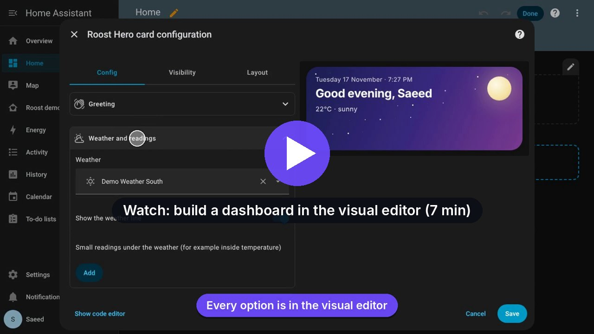
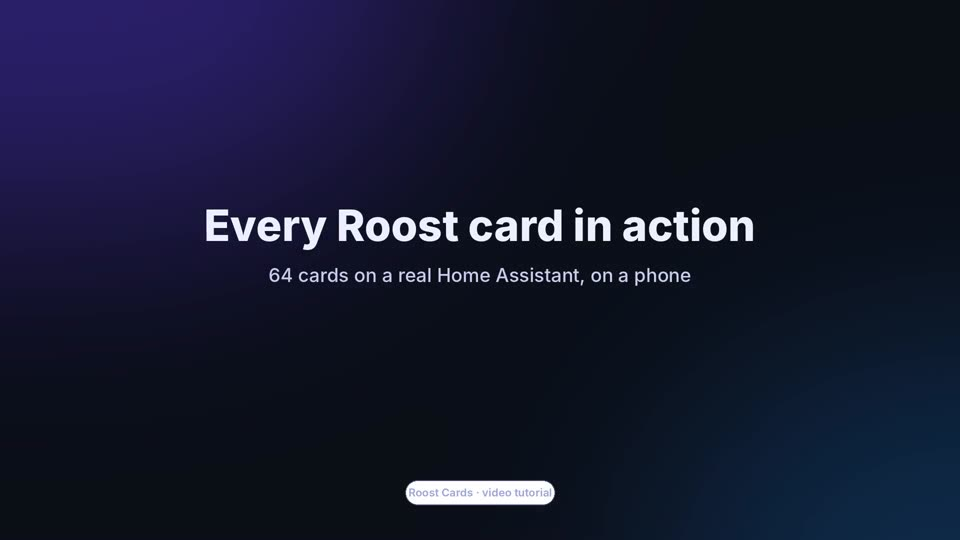

# Videos

Both videos are recorded on a real Home Assistant with its built-in demo devices: the editor, the options and the cards are the real ones.

## Build a dashboard in the visual editor · 7 minutes

1. Make a new dashboard (Settings → Dashboards → Add dashboard)
2. Tap the pencil, then **+** to add a card, and search **roost**: every Roost card shows with a live preview
3. Roost Hero, Chips, Thermostat, Light, Curtain, Media, Alarm, Buttons, Rooms and Nav: pick each one, choose your device, open its option groups, Save
4. Tap **Done**, then use the dashboard on a phone: switch between the four rooms, drag the thermostat dial, slide the light, close the curtains, arm the alarm

## Every card in action · 5 minutes

Every card on one page, each one used: buttons, scenes, light and dark, rooms, tiles, a group tile with its round button, a room with one slider for its lights, the thermostat, lights, the fan dial, curtains, TV and remote, alarm with its keypad, lock, camera, people, alerts, the timeline, batteries, the popup, clock, prayer times, weather, agenda, to-do, timer, energy, sensors, your own values, the robot vacuum, water tank, pool, pet feeder, baby's room, internet, Grocy (fridge, shopping and chores), bins, medicine, house modes, sleep, the car, the family map and the bottom bar.

Prefer to read? [Build a phone home screen](03-phone-home-screen.md) covers the same steps in writing.

[← Back to the README](../../README.md)
