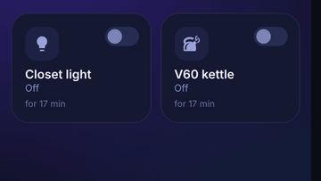
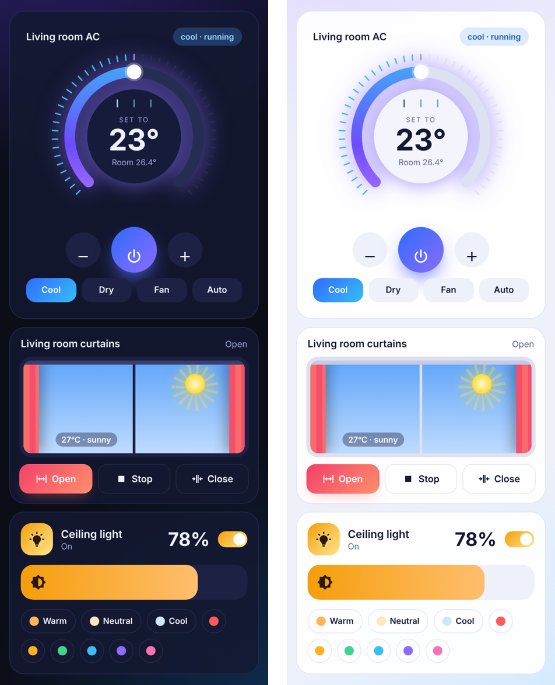

# 2 · Add your first card

**Time: 1 minute.** We'll add a **Roost Tile** for a light. Every Roost card works the same way.

1. Open the dashboard you want to change.
2. Tap the **pencil** ✏️ at the top right (on some dashboards: **three dots → Edit dashboard**).
3. Tap **Add card** (or the **+** in a section).
4. Type **Roost** in the search box and choose **Roost Tile**.
5. In **Device**, pick your light.
6. Under **Look**, tap a colour dot, for example the orange one (**Amber**). The preview on the right changes as you go.
7. Tap **Save**, then **Done** at the top.

Tap the tile: the light switches. Hold it: its details open.

## Make it yours

Every Roost card's settings are laid out the same way, top to bottom:

| Part | What you change |
|---|---|
| **Start from** | **Simple** shows only the main control, **Detailed** shows everything. One tap, then change anything below |
| **Device** (open) | Which device, its name and icon |
| **Look** | Tap a small picture of each style, a colour dot, and **Auto / Light / Dark** |
| The card's own parts | For example *Opens with the sun* on the curtain |
| **More look settings** | Roundness, size, glow, icon box and the rest |
| **What it shows** | The switch, the state line, "for 5 min", the power used |
| **Tap and hold** | What a tap and a long press do, **Ask before switching**, **Lock** |
| **More** (closed) | *Not working right now*, frosted glass, **Only show this card to these people**, language and numbers |

Settings whose name is not enough have a short explanation under them.

> **Tip:** the first time you tap a card that does more when held, a small note says so. Hold a card to see its details.

**Next:** [Build a phone home screen →](03-phone-home-screen.md)
