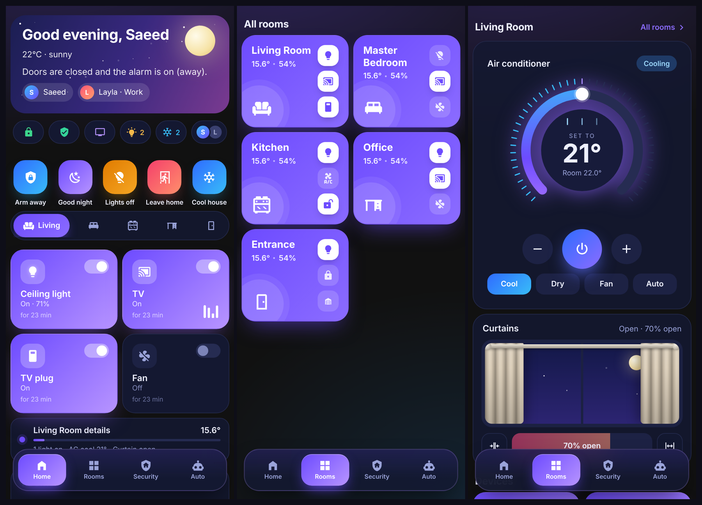
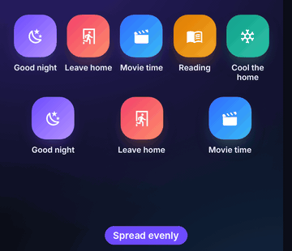
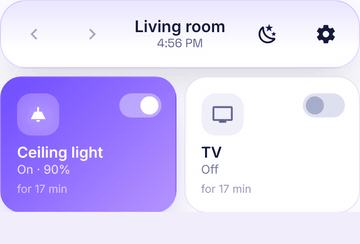
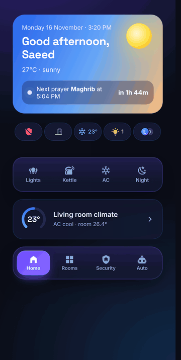
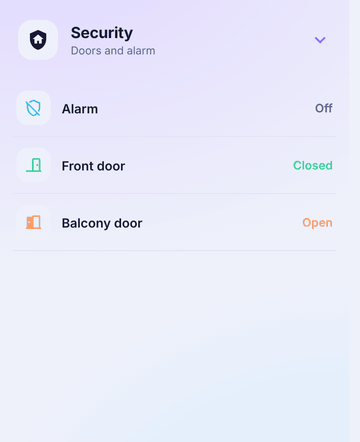

# 3 · Build a phone home screen

**Time: 10 minutes.** At the end you'll have this:



## Steps

1. **Settings → Dashboards → Add dashboard → New dashboard from scratch.** Name it *Home*.
2. Open it and tap the **pencil** ✏️. Keep the **Sections** layout.
3. Add the cards from top to bottom, each with **Add card → search "Roost"**:

| # | Card | What to pick in its editor |
|---|---|---|
| 1 | **Roost Hero** | Your weather. Under *Next*, add your prayer times (or any time sensors) |
| 2 | **Roost Chips** | Your doors, alarm, lights, air conditioners and people |
| 3 | **Roost Buttons** | 3 to 5 quick actions, for example *Good night*, *Lights off* |
| 4 | **Roost Rooms Selector** | One room per button; pick each room's devices |
| 5 | **Roost Nav** | The pages of your dashboard (Home, Rooms, Security…) |

4. For cards 1 to 5, open **Layout** in the card editor and choose **full width**.
5. Tap **Done**.

**More you can add:**
- **Roost Scenes** puts all your scenes in one row of round buttons, spread evenly or stacked like a dock.

  
- **Roost Top Bar** gives the top of the screen back and forward buttons, the page's name and the time.

  

> **The bottom bar (Roost Nav)** floats at the bottom of the screen. While you edit, it sits in its own place with a small note, so you can tap it to change it. Style the bar on your first page; the bars on your other pages copy its look by themselves.

## Make it look like an app: Roost Page

Want even spacing, the night-sky background and room for the bottom bar, exactly like the phone dashboard? Put a **Roost Page** in a **Panel** view and add your cards inside it. To group cards in a rounded box with a title (like the "Rooms" or "Security" box), use **Roost Panel**. Panels can fold open and closed.

**Tip: if you like to tap a card and edit it on the spot**, skip the Roost Page and use a normal **Sections** view with one column instead. Open the view's settings (the pencil next to its name), choose **Sections**, set the number of columns to 1, and paste the night-sky background from [the Roost Page notes](../cards.md#roost-page). Every card then keeps its own edit button.

| Roost Page | Roost Panel |
|:-:|:-:|
|  |  |

## Prefer to paste?

Edit the dashboard → three dots → **Raw configuration editor**, and paste this, then change the names to yours:

```yaml
views:
  - title: Home
    path: home
    type: sections
    max_columns: 1
    sections:
      - type: grid
        cards:
          - type: custom:roost-hero
            weather: weather.home
            upcoming_title: Next prayer
            upcoming:
              - { name: Maghrib, entity: sensor.maghrib }
          - type: custom:roost-chips
            entities: [binary_sensor.front_door, alarm_control_panel.home, light.living_room, climate.living_room, person.saeed, person.layla]
          - type: custom:roost-buttons
            items:
              - { name: Good night, icon: mdi:weather-night, tap_action: { action: perform-action, perform_action: script.good_night } }
              - { name: Lights off, icon: mdi:lightbulb-off, tap_action: { action: perform-action, perform_action: light.turn_off, target: { entity_id: all } } }
          - type: custom:roost-rooms
            rooms:
              - { name: Living, icon: mdi:sofa, entities: [light.living_room, climate.living_room, cover.living_room] }
              - { name: Bedroom, icon: mdi:bed-king, entities: [light.bedroom, climate.bedroom] }
          - type: custom:roost-nav
            items:
              - { name: Home, icon: mdi:home-variant, path: /home-roost/home }
              - { name: Rooms, icon: mdi:view-grid, path: /home-roost/rooms }
```

**Next:** [Rooms that switch with a tap →](04-rooms.md)
