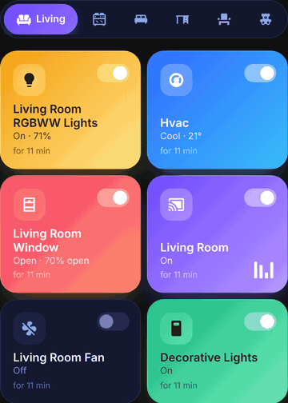
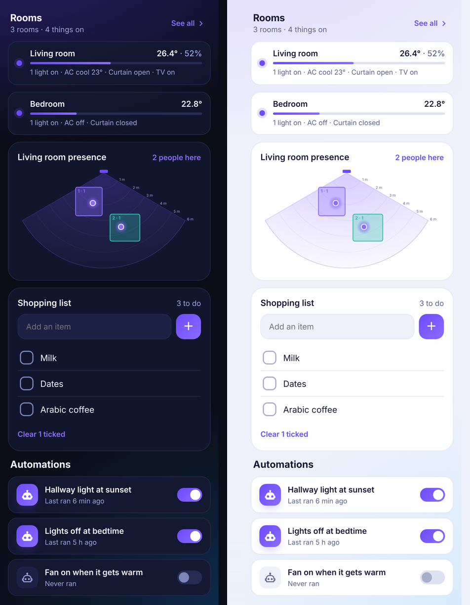

# 4 · Rooms that switch with a tap

**Roost Rooms Selector** shows one room at a time. Tap a room (or swipe left and right) and its devices appear instantly.

## Steps

1. Add a **Roost Rooms Selector** card (*Add card → Roost Rooms*).
2. Under **Rooms**, tap **Add** for each room. Give it a **name**, an **icon**, and pick its **devices**. Each device becomes a tile, coloured by type: lights amber, ACs blue, curtains coral, TVs purple, plugs green, fans teal.
3. Open **Room buttons** to choose the shape, and turn on **Show how many things are on** for a small number badge.
4. Open **Behaviour**: **Swipe** to change room, and **Open the last room I used**.

## Follow me

Open **Follow me** and turn on **Open the room I am in**. When a presence or motion sensor in a room turns on, the card switches to that room by itself, so your phone always shows where you are.

- Each room uses any presence or motion sensor in the Home Assistant **area with the same name**. To use a different one, pick it under the room's **Presence sensor for Follow me**.
- If two rooms see you, the one that saw you last wins.
- When you pick a room yourself, it waits two minutes before following you again (change it with **After I pick a room myself, wait**).
- Have Bluetooth room tracking (for example Bermuda)? Pick your phone's area sensor under **Or from a Bluetooth room tracker**. It follows your phone instead of the sensors.

## A room at a glance

Want a list of rooms with their temperature instead? Use **Roost Room**, one per room. It shows a temperature bar (orange when too hot), humidity, and a short line like *"1 light on · AC cool 23° · Curtain open"*. Set **Tap opens** to the room's page.

**Next:** [Air conditioners and curtains →](05-climate-and-curtains.md)
