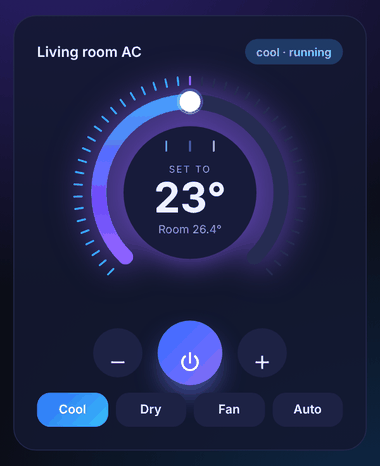
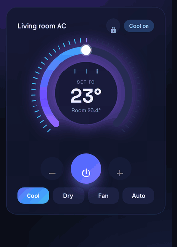
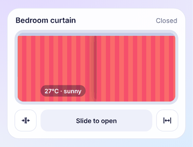
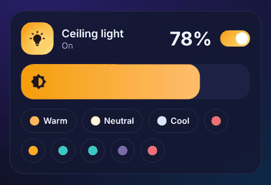

# 5 · Air conditioners and curtains

## Drag the temperature

**Roost Thermostat** has a dial you drag with your finger. Let go to send the new temperature. **−** and **+** change it by one step; the power button and the mode buttons work as you'd expect.

1. *Add card → Roost Thermostat* and pick your air conditioner.
2. Optional: **Room temperature sensor** shows the room's real temperature under the setting.
3. **Look:** *Nest dial* (the default) is the phone dashboard's own dial: a cyan-to-purple ring that glows and little breeze bars that breathe while the AC runs. *Classic* lets you pick your own dial colour.

## Curtains that really move

**Roost Curtain** draws a window with curtains that slide while they move.

1. *Add card → Roost Curtain* and pick your curtain.
2. **Behind the window:** the sky (follows the sun), **live weather** (rain falls, clouds drift; it only moves while the curtain is open), **your own picture** (for example `/local/view.jpg`, with an optional night picture), or nothing.
3. **Kind:** two curtains, one curtain (left or right), or a **roller blind**.

### My curtain says "open" when it's closed

Some curtain motors report it the wrong way round (99% open when they are really 1% open). Open **What it shows** and turn on **Reverse**. The picture, the words and the buttons then follow the real curtain. Tiles have the same **Reverse** setting.

## A light you dim with your finger

**Roost Light**: drag the bar for brightness, tap **Warm / Neutral / Cool**, or a colour dot for colour bulbs.

**Next:** [Security →](06-security.md)
