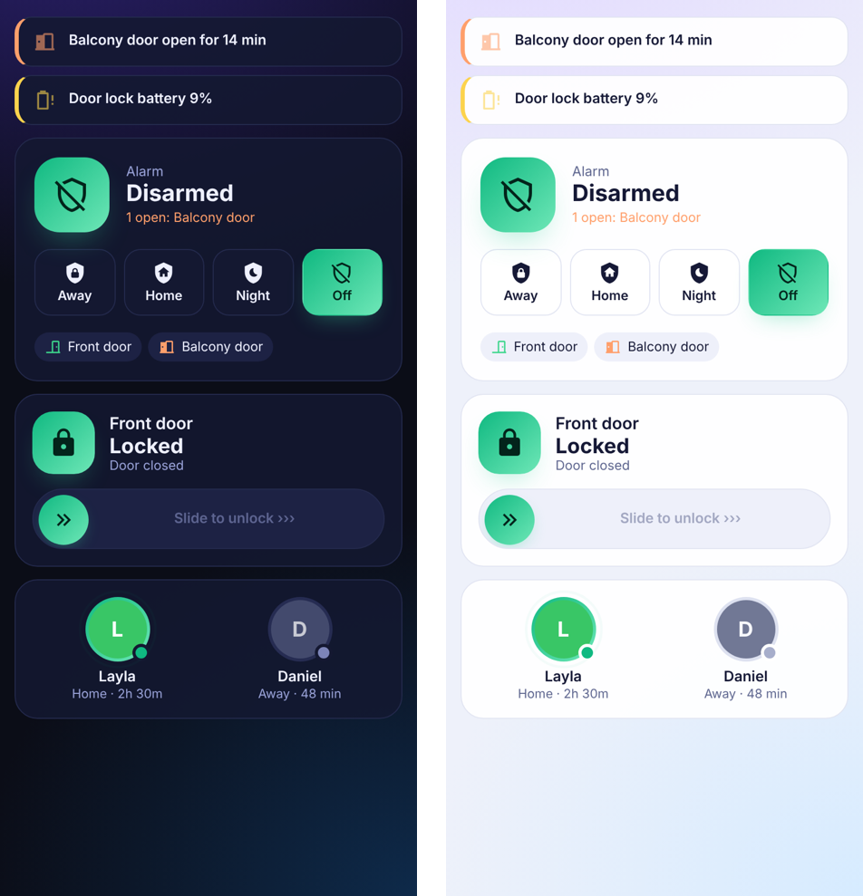
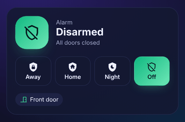
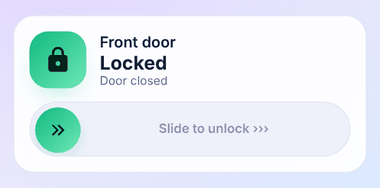

# 6 · Security: alarm, lock, alerts and people

## Alarm

1. *Add card → Roost Alarm* and pick your alarm (for example **Alarmo**).
2. Choose the buttons you want: **Away**, **Home**, **Night**, **Holiday**.
3. Add your **doors and windows**. The card warns you before arming if one is open.
4. Keep **Ask before arming or disarming** on, so a pocket tap can't arm the house. If your alarm needs a code, a keypad appears.
5. Prefer something smaller? Set **Style** to *A row of pills*: the Alarm title with **Disarm · Arm home · Arm away** underneath, exactly like the phone dashboard's Security box. It fits nicely inside a **Roost Panel**.

## Lock

**Roost Lock** opens with a **slide**, so it can't be unlocked by accident; a tap locks it. It shakes when the lock is jammed. Works for garage doors too.

## Alerts

**Roost Alerts** only appears when something needs you: a **low battery** (all battery sensors, below the level you choose), a device that went **offline**, a **door left open** too long, or **your own rules** (for example *"Server cabinet too hot"* above 32°). When all is fine, it hides itself.

## People

**Roost People** shows who is home with a green ring, and for how long.

**Next:** [Use it with Athom Hub →](07-with-athom-hub.md)
