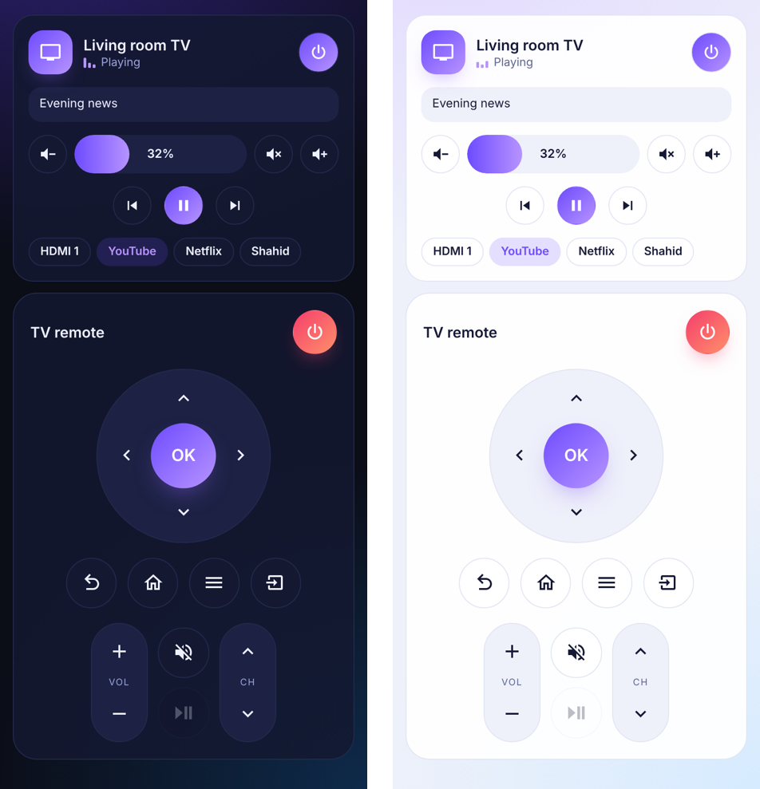

# 7 · Use it with Athom Hub

[Athom Hub](https://github.com/HRadhi4/Athom_For_Dummies) turns Athom IR/RF remotes and presence sensors into real Home Assistant devices. Two Roost cards are made for it.

## A remote on your phone

1. *Add card → Roost Remote*.
2. In **Athom Hub remote**, type the remote's name exactly as in Athom Hub (for example *Living room TV*).
3. Done. Its buttons are matched to the keys by their names (*Power*, *Up*, *OK*, *Vol up*…). Keys the remote doesn't have are greyed out.

It also works with any `remote` entity, or a TV (`media_player`).

## Who is in the room

**Roost Presence Map** shows the room from above, as the Athom presence sensor sees it: people as glowing dots that move, and the zones you drew in Athom Hub with how many people are inside each.

1. *Add card → Roost Presence Map*.
2. Pick the **presence sensor** (the device).
3. Set **Room depth to show** to the size of your room.

**Next:** [Looks, light and dark, tablets →](08-looks.md)
