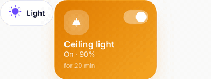
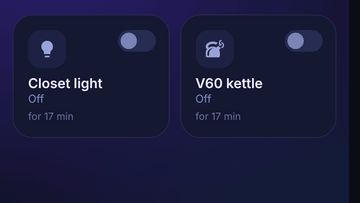
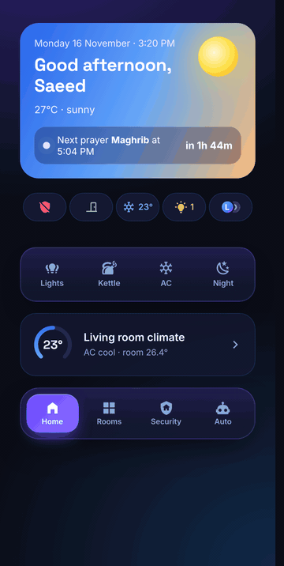
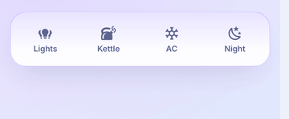

# 8 · Looks, light and dark, tablets

## Light and dark

Every card follows Home Assistant's light or dark mode by itself. Add a **Roost Light/Dark** button to switch the mode on this screen with one tap (it can also offer *Automatic*). To keep a card always dark or always light, set **Theme** in its editor.

## Frosted glass

Every card can be **solid**, **frosted glass** or **fully clear**. Open **See-through (frosted glass)** in a card's editor and move the two sliders: how much shows through, and how strong the blur is. It looks best over a picture or a colourful background.

The bottom bar (**Roost Nav**) is frosted glass already; the same sliders tune it. Set them on the bar of your first page: the bars on every other page follow it.

## Your own background picture

In a **Roost Page**, put your picture in Home Assistant's `www` folder and set **Your own background picture** to `/local/roost/wall.jpg`. Darken or soften it with the sliders; frosted-glass cards blur it.

## Buttons that light up

**Roost Nav** and **Roost Buttons** share the same choices for a button that is on: **filled** (with a glow), **soft**, **pill**, **a line under it**, **a dot under it**, or **only the icon** coloured. Their bar can be **frosted glass**, **solid** or **none**.

## Colours

Every colour setting offers ready-made colours (purple, blue, coral, green, amber, teal, pink, slate), **Selected purple**, or **My own colours** (pick a start and an end colour).

## Tablets

- **Roost Nav** turns into a rail at the side on screens 768 px and wider.
- Use more **Tiles per row** in Roost Rooms, and put Roost Clock, Weather and Agenda side by side for a wall tablet.

## Moving things

Everything that moves is short and gentle, and **all animations stop** if *Reduce motion* is turned on in your phone's accessibility settings.

[← Back to the README](../../README.md)
