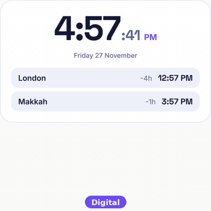
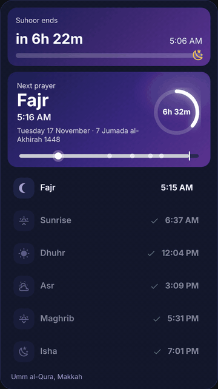

# 10 · Clock and prayer times

## A clock with eight faces

**Roost Clock** is only a clock, but a very flexible one: **digital, analog, minimal, flip, ring, words, neon and LCD**.



1. *Add card → Roost Clock*.
2. **Clock face:** pick one of the eight.
3. **Seconds**, **24-hour**, the **date** (long, short, numbers or none) and the **Hijri date** are switches.
4. **Another place:** fill in **Time zone** (for example `Asia/Riyadh`) and a **Label** (for example *Makkah*).
5. **World clocks underneath:** add other cities, each with its time and how many hours apart it is.
6. Analog faces: choose the **Numbers** (western, eastern ١٢٣, roman or none) and the **Marks** around the edge.

## Prayer times

**Roost Prayer Times** shows today's prayers, the next one with a countdown ring, a line across the day and the Hijri date.



1. *Add card → Roost Prayer Times*.
2. **Where the times come from:**
   - **Calculated here** (no internet needed): pick your **Method**, for example *Umm al-Qura, Makkah*, *Muslim World League*, *Egypt*, *Gulf*, *Jafari* or *Tehran*.
   - **Online:** the same methods, fetched from aladhan.com.
   - **My own sensors:** use the times from your own calendar. Any prayer you don't give a sensor is calculated.
3. Under **Times to show**, pick which prayers to show (Imsak, midnight and the last third of the night are there too), the **names** (English, Arabic or both) and the **numbers** (western or eastern).
4. Times a minute or two off from your mosque? Use **Move a time by minutes**.

### Using your own calendar (for example the Al-Hadi calendar)

Set **Where the times come from** to *My own sensors*, fill in **Name of your calendar**, and pick a sensor for each prayer you have:

```yaml
type: custom:roost-prayer
source: sensors
calendar_name: Al-Hadi calendar
imsak_entity: sensor.my_calendar_imsak
fajr_entity: sensor.my_calendar_fajr
```

The name shows at the bottom of the card, so you always know which calendar it follows.

[← Back to the README](../../README.md)
