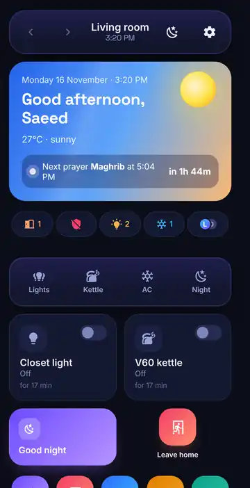

# 11 · Try cards before you own the device

Some cards can show **pretend devices**, so you can see how they look and feel before you buy anything: **Roost Fan, Lock, Camera, Timer and Remote**.

1. *Add card →* one of those cards.
2. Turn on **Show sample data**.
3. Tap away: the fan spins and changes speed, the lock slides open, the timer counts down, the doorbell rings on the camera. Nothing is sent to Home Assistant.

```yaml
type: custom:roost-fan
sample: true
```

Turn **Show sample data** off and pick your real device when it arrives.

## See every card at once



[← Back to the README](../../README.md)
