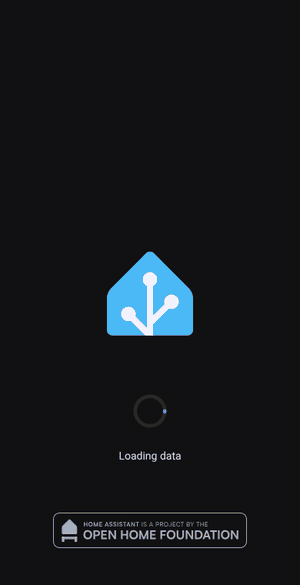

# 12 · Ready dashboards made from your home

Roost can build two whole dashboards for you from your own rooms and devices: one for phones and one for a wall tablet. You don't add any cards yourself.



## The first time

The first time an admin opens Home Assistant after installing Roost, a small window asks: **“Roost Cards is ready. Make them?”**

- **Make them:** two dashboards appear in the sidebar, **Roost Home** (phone) and **Roost Tablet view** (tablet).
- **Not now:** nothing changes, and Roost will not ask again.

## What is on them

- **Home:** a greeting with the weather, chips for doors, locks, lights and AC, your scenes, a room picker with each room's devices, air conditioners, curtains, music, the alarm, locks, cameras, who is home, the weather, readings, your calendar and to-do list, batteries and a timeline of what happened.
- **Rooms:** one block for each room (area): the room with “Someone here”, one slider for all its lights, and a tile for each device.

They follow your home by themselves: add a light to a room in Home Assistant and it appears.

## Make one yourself, or later

*Settings → Dashboards → Add dashboard* → under **Community dashboards** pick **Roost Home (phone)** or **Roost Home (tablet)** (Home Assistant 2026.5 or newer).

Or make a new empty dashboard, open the three dots → *Raw configuration editor*, and paste:

```yaml
strategy:
  type: custom:roost          # or custom:roost-tablet
  hide: [camera, light.porch] # optional: leave out a whole kind or single devices
```

## Change it by hand

Open the dashboard → pencil → three dots → **Take control**. It becomes a normal dashboard you can edit card by card (it then stops following your home by itself).

## Tips

- Put your devices in **areas** (*Settings → Areas*) so the rooms come out right.
- Hidden entities and settings/diagnostic entities are left out.

[← Back to the README](../../README.md)
