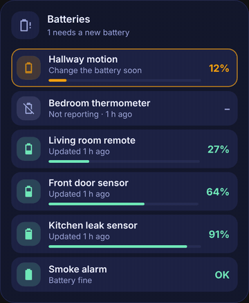
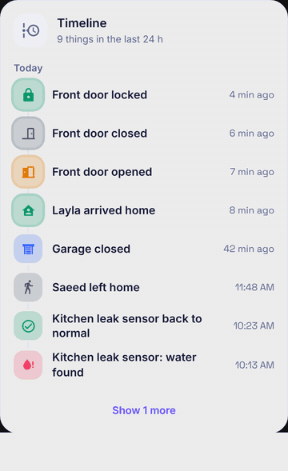
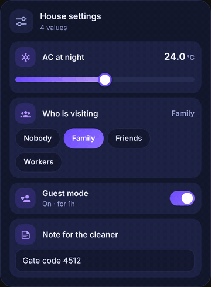
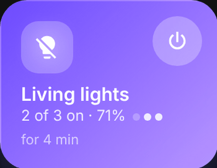

# 13 · Batteries, Timeline and your own values

Three cards that need no setting up.

## Batteries

1. *Add card →* **Roost Batteries**. That's it: it finds every battery by itself, lowest first.
2. Change **Low below** (20 % to start) and pick **Only the low ones** for a calm “All good” when nothing needs doing.
3. Something you don't care about (a phone)? Put it under **Leave out**.

## Timeline

1. *Add card →* **Roost Timeline**. It shows people coming and going, doors, windows, locks, curtains, the alarm and leaks.
2. Turn on **Include motion** only if you want every movement (busy homes get many rows).
3. Or pick exactly which devices to follow.

## Values

Helpers are your own settings: a number (night AC temperature), a list (who is visiting), a switch (guest mode), a short text (a note).

1. Make them under *Settings → Devices & services → Helpers → Create helper*.
2. *Add card →* **Roost Values** → add each helper. Numbers get a slider, lists get buttons, switches a switch, texts a box.

## Group tile and the round button

In a **Roost Tile**: under **Group** add more lights or curtains; under *What it shows* → **Quick control** pick **A round button**. The button switches them all; tapping the tile opens every control. **Warn when it hasn't reported** shows “Not seen for 2 days”.

## One slider for a room's lights

In a **Roost Room** → *Look* → **One slider for all the room's lights**. Add the room's motion sensor to its devices to see “Someone here”.

[← Back to the README](../../README.md)
