# 14 · Real-looking curtains, blinds, garage, plant, pet and pool

Six cards now come in real-looking styles. You pick them in the card's editor, no code.

## Curtains and blinds

1. Edit the **Roost Curtain** card → open **Look**.
2. **Kind:** two curtains, one curtain, or **Blind**.
3. **Curtain look:** *Pinch pleat*, *Wave on rings* or *Sheer behind a blackout*. For blinds, **Blind look:** *Venetian slats*, *Roller* or *Roman shade*.
4. **Fabric or finish:** linen, sand, sage, navy, charcoal, blush, white, oak, walnut, stone grey or black.
5. Under **What it shows → Controls**, keep **One slide bar with two small arrows**. Drag the bar to any position; tap it while it moves to stop.

| Pinch pleat | Wave | Sheer |
|:-:|:-:|:-:|
| 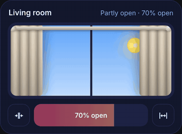 | 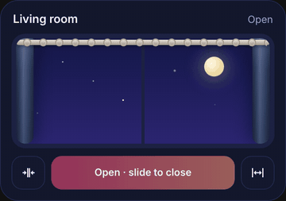 | 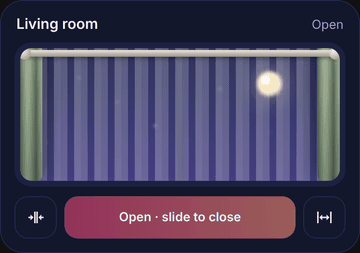 |

| Venetian | Roller | Roman |
|:-:|:-:|:-:|
| 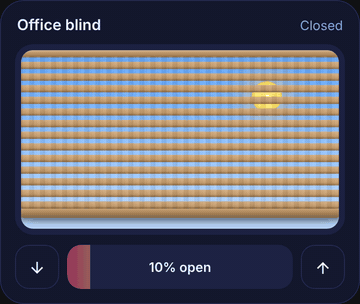 | 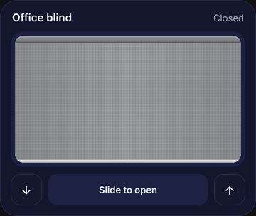 | 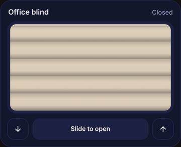 |

## Garage door

**Roost Garage** → **Garage door look:** *Sectional panel door* or *Aluminium roller shutter*, and a **Finish**.

| Sectional | Roller shutter |
|:-:|:-:|
| 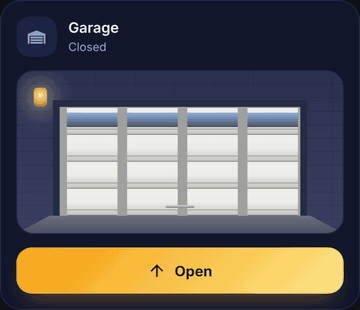 | 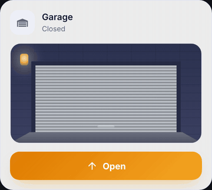 |

## Plant, pet and pool

Each has a **Look** setting with three choices.

| Plant: portrait | Plant: health ring | Plant: inside the pot |
|:-:|:-:|:-:|
| 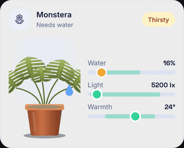 | 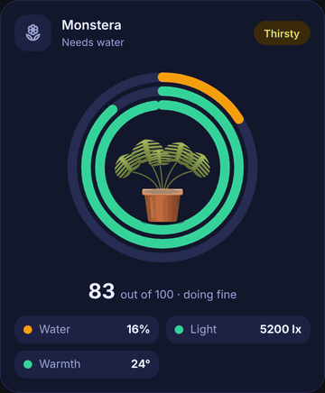 | 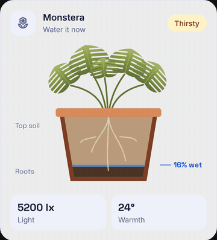 |

| Pet: bowls | Pet: feeder | Pet: portrait |
|:-:|:-:|:-:|
| 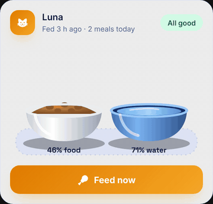 | 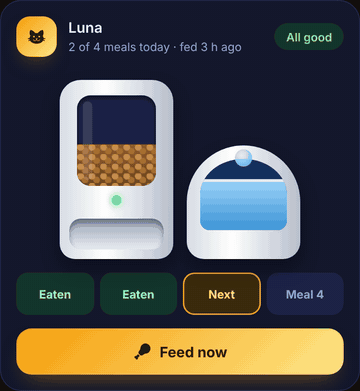 | 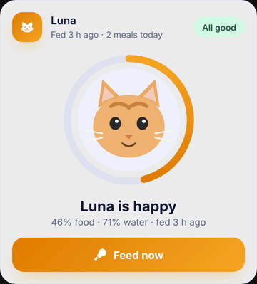 |

| Pool: from above | Pool: side view | Pool: gauges |
|:-:|:-:|:-:|
| 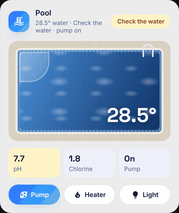 | 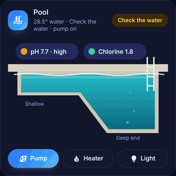 | 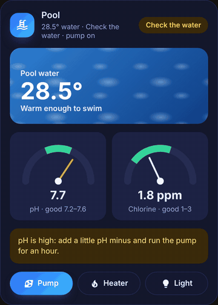 |

For the pool, also pick the **Pool tiles** colour: blue mosaic, turquoise, dark slate or white plaster.

[← Back to the README](../../README.md)
