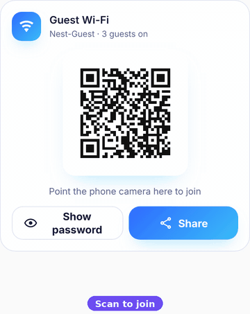
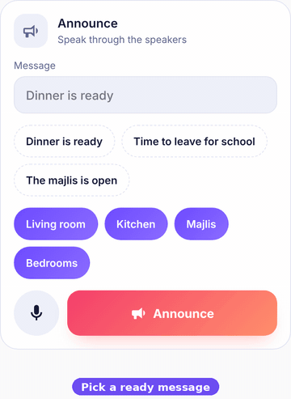
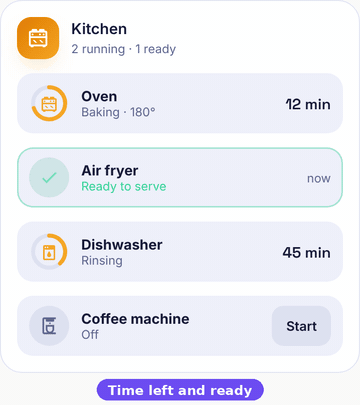
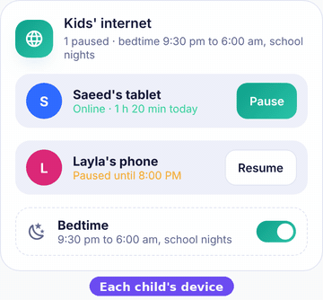
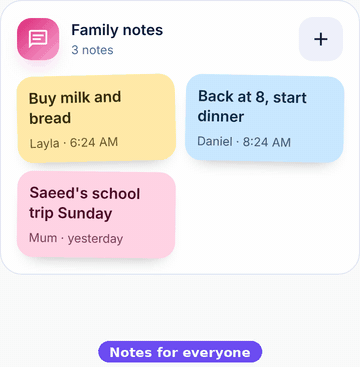
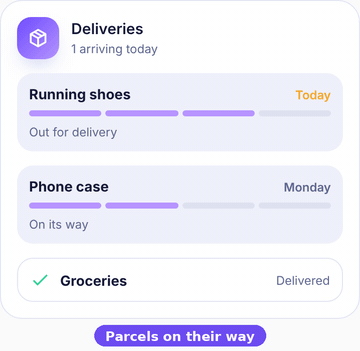
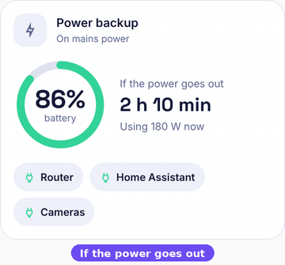
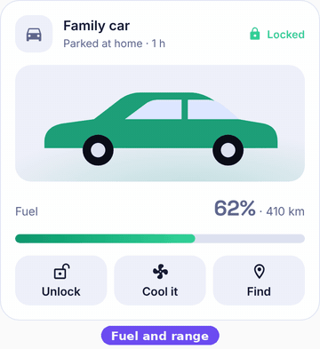

# 15 · Guest Wi-Fi, Announce, Kitchen and more

Seven new cards, plus petrol cars in Roost Car. Every one works with **Sample** turned on, so you can try it before you have the devices.

## Guest Wi-Fi

1. *Add card →* **Roost Guest Wi-Fi**.
2. Type the guest network name and password, and pick the security (most homes: **WPA**).
3. Guests point their phone camera at the code to join. **Show password** and **Share** are there too.
4. Want the password only on family screens? Under **More**, tick the people in **Only show this card to these people**.

## Announce

1. *Add card →* **Roost Announce**, then pick your speakers under **Device**.
2. Pick a voice (Home Assistant Voice devices need none).
3. Add ready messages, one per line ("Dinner is ready").
4. On the dashboard: tap the rooms, tap a message or type one, then **Announce**.

## Kitchen

1. *Add card →* **Roost Kitchen**, then add each appliance under **Appliances**.
2. Pick what shows its state, and if you have them, the time left and the temperature.
3. When it says done, the row turns green: **Ready to serve**.

## Kids' internet

1. Your router's integration in Home Assistant needs an internet switch for each device (many routers have one).
2. *Add card →* **Roost Kids' internet**, then add each child's phone or tablet and give it a name.
3. Tap **Pause**, then tap again to be sure. **Resume** turns it back on.

## Family notes

1. Make a list: *Settings → Devices & services → Add integration →* **Local to-do**, name it "Family notes".
2. *Add card →* **Roost Family notes** and pick that list.
3. Tap **+** to write a note. Tap a note twice to remove it.

## Deliveries

1. Add a parcel-tracking integration (for example **17TRACK**).
2. *Add card →* **Roost Deliveries** and pick its sensor. Parcels arriving today come first.

## Power backup

1. Add your UPS to Home Assistant (for example with **Network UPS Tools**).
2. *Add card →* **Roost Power backup**, pick the battery, and if you have them, the time left and the status.
3. Under **What it keeps on**, write one thing per line (Router, Cameras).

## Petrol or hybrid car

1. *Add card →* **Roost Car**, and choose **Petrol or hybrid** at the top.
2. Open **Petrol or hybrid car** and pick the fuel level, lock, air conditioning and where it is.
3. Unlocking asks for a second tap, so it never opens by mistake.
