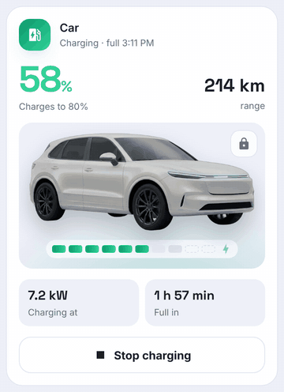
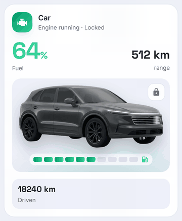
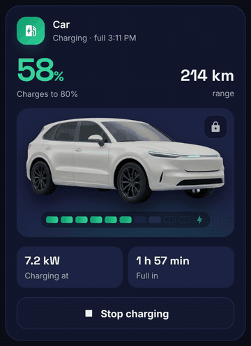
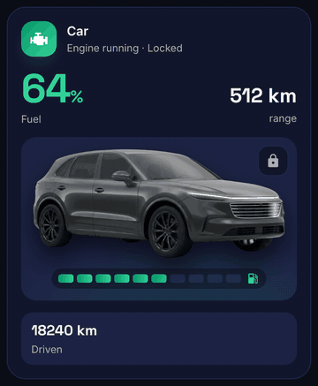

# 15 · Your car: electric or petrol

One **Roost Car** card for any car. Pick **Electric** or **Petrol**, or let the card find out from your devices.

| Electric | Petrol |
|---|---|
|  |  |
|  |  |

## Add it

1. *Add card →* **Roost Car**. It opens with sample data, so you can see it before choosing anything.
2. Turn off **Show sample data**.
3. **Car type**: *Electric*, *Petrol*, or *Find out from the devices* (a fuel level and no battery means petrol).
4. Open **Device** and choose what your car gives Home Assistant. The list only shows what fits your car type:
   - Electric: **Battery level**, **Range**, **Charging power**, **Charging on/off**, **Plugged in**, **Charge limit**
   - Petrol: **Fuel level**, **Range**, **Engine running**
   - Both: **Car lock** and **Distance driven**
5. Under **Look** → **Picture**, pick **Realistic car**. (*Side drawing* is the older picture for electric cars.)

## What the lights mean

| You see | It means |
|---|---|
| Light bar glows softly | The car is unlocked |
| Light bar pulses blue, a light runs along it | Charging (electric) |
| Light sweeps once along the bar | It was just unlocked (electric) |
| Headlights on, a shine runs over the grille | The engine is running (petrol) |
| Headlights flash twice | It was just unlocked (petrol) |
| Lights off, the car a little darker | Locked |
| The level turns red | Battery 20 % or less, fuel 15 % or less |

## Tap

- **The lock button** on the picture opens the lock, where you slide to lock or unlock. A stray tap never opens your car.
- **The car** opens the same lock (or the battery or fuel, if there is no lock).
- **Start / Stop charging** shows when *Charging on/off* is a switch.

## Your own picture

Prefer your real car? Put a see-through PNG in your `www` folder and write `/local/my-car.png` under **Look** → **Your own car picture**. The battery or fuel bar and the lock button stay on it.

In Arabic the car turns to face the other way, with its lights and the lock button moving with it.

[← Back to the README](../../README.md)
