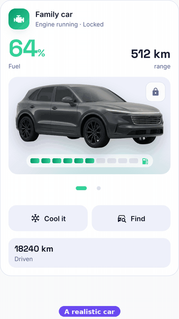
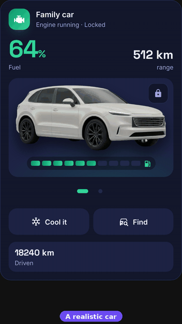
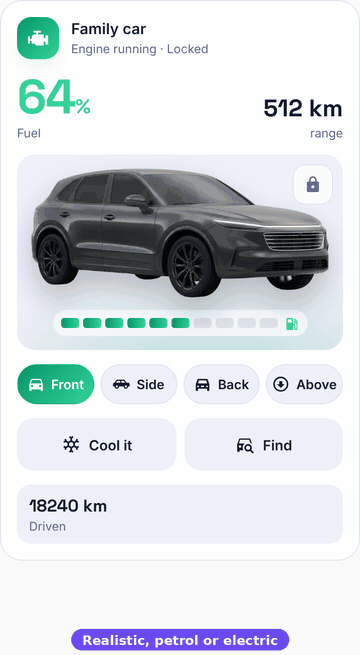

# 16 · Your car: realistic, in its own colour, and more than one

One **Roost Car** card for any car, petrol or electric. It can show a realistic car in your car's colour, and more than one car: swipe between them.

 

## Add it

1. *Add card →* **Roost Car**. It opens with two sample cars, so you can try everything before choosing anything. Swipe the picture to see the second one.
2. Turn off **Show sample data**.
3. **Car type**: *Petrol or hybrid*, *Electric*, or *Find out from the devices* (a fuel level and no battery means petrol).
4. Open **Device** and choose what your car gives Home Assistant. The list only shows what fits your car type:
   - Petrol: **Fuel level**, **Range**, **Engine running**
   - Electric: **Battery level**, **Range**, **Charging power**, **Charging on/off**, **Plugged in**, **Charge limit**
   - Both: **Car lock** and **Distance driven**
5. Open **Cool it and find it** if your car can do more:
   - **Start the AC**: shows a **Cool it** button.
   - **Flash the lights**: **Find** flashes them. Without it, **Find** shows where the car is.
   - **Where it is**: hold the car's picture to see it on the map.
   - **A door open** and **Boot open**: they glow on the picture, with a line under it.

## Make it look like your car

Under **Look**:

- **Picture**: *Realistic* (it matches the car type: a petrol car has a grille, an electric one a light bar), or a drawn *SUV*, *sedan*, *hatchback* or *pickup*.
- **The car's colour**: tap a dot. White, silver, grey, black, red, blue or sand.
- **Seen from**: the side (or the front corner for the realistic car), or from above, which shows exactly which door is open.
- **Moving picture**: turn it off for a still picture.
- **Your own car picture**: a see-through PNG in your `www` folder, written as `/local/my-car.png`. It stays on your Home Assistant.

## More than one car

Open **More cars** and add each car with its own name, type, devices, picture and colour. On the dashboard, swipe the picture left or right, or tap the dots under it. Light or dark and the card's colour are shared by all the cars.

## What the lights mean

| You see | It means |
|---|---|
| Light bar glows softly | The car is unlocked |
| Light bar pulses blue, a light runs along it | Charging (electric) |
| Light sweeps once along the bar | It was just unlocked (electric) |
| A shine runs over the grille | The engine is running (petrol) |
| Headlights flash twice | It was just unlocked (petrol) |
| Cold air moving over the windows | The AC is on |
| All the lights flashing | You tapped **Find** |
| A door or the boot glows orange | It is open |
| Lights off, the car a little darker | Locked |
| The level turns red | Battery 20 % or less, fuel 15 % or less |

## Tap

- **The lock button** on the picture opens the lock, where you slide to lock or unlock. A stray tap never opens your car.
- **The car** opens the same lock (or the battery or fuel, if there is no lock). **Hold** it to see where it is.
- **Swipe** the car to see the next one.
- **Start / Stop charging** shows when *Charging on/off* is a switch.

In Arabic the car turns to face the other way, with its lights, the lock button and the swipe moving with it.

[← Back to the README](../../README.md)
